---
## Author
author:
  name: Агаева Зейнаб Фуад кызы
  email: 1032245473@rudn.ru
  affiliation:
    - name: Российский университет дружбы народов
      country: Российская Федерация
      postal-code: 117198
      city: Москва
      address: ул. Миклухо-Маклая, д. 6

## Title
title: Лабораторная работа №4
subtitle: Адресация IPv4 и IPv6. Двойной стек
license: CC BY
date: today
date-format: "YYYY-MM-DD"
---

# Цели и задачи работы

## Цель лабораторной работы

Настроить двойной стек адресации IPv4 и IPv6 в локальной сети, проверить связность между подсетями и проанализировать трафик ARP, ICMP и ICMPv6 в Wireshark.

# Процесс выполнения лабораторной работы

## Создаю топологию сети с двойным стеком

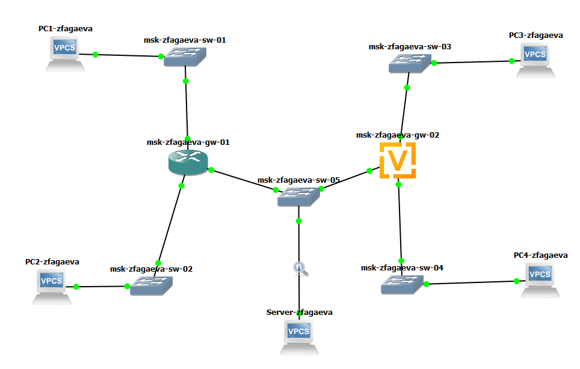{ #fig:001 width=70% height=70% }

## Настраиваю IPv4 на PC1

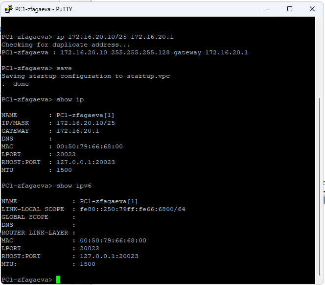{ #fig:002 width=70% height=70% }

## Настраиваю IPv4 на PC2

{ #fig:003 width=70% height=70% }

## Настраиваю IPv4 на сервере

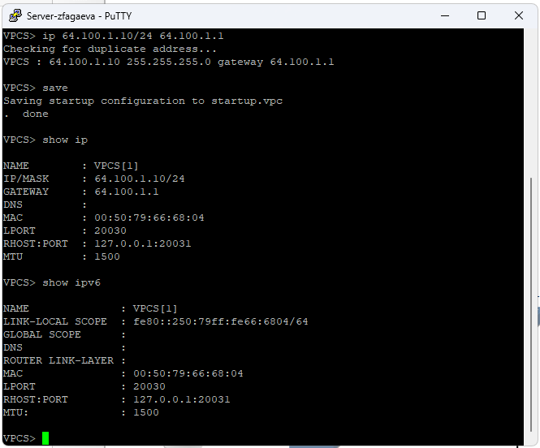{ #fig:004 width=70% height=70% }

## Настраиваю IPv4-интерфейсы маршрутизатора FRR

{ #fig:005 width=70% height=70% }

## Проверяю конфигурацию маршрутизатора FRR

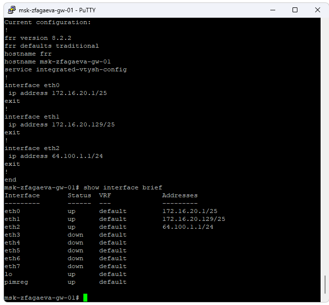{ #fig:006 width=70% height=70% }

## Проверяю IPv4-соединение с PC1

{ #fig:007 width=70% height=70% }

## Проверяю IPv4-соединение с PC2

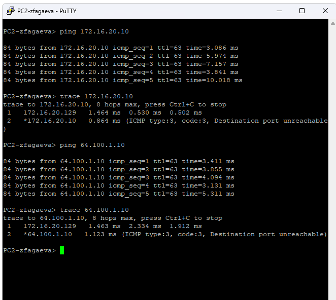{ #fig:008 width=70% height=70% }

## Настраиваю IPv6 на PC3

{ #fig:009 width=70% height=70% }

## Настраиваю IPv6 на PC4

{ #fig:010 width=70% height=70% }

## Настраиваю двойной стек на сервере

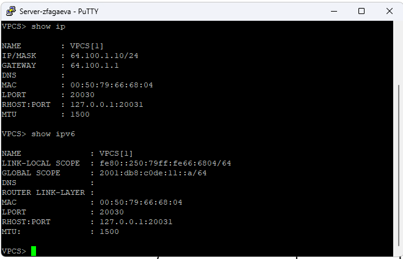{ #fig:011 width=70% height=70% }

## Настраиваю IPv6 на маршрутизаторе VyOS

{ #fig:012 width=70% height=70% }

## Проверяю IPv6-интерфейсы VyOS

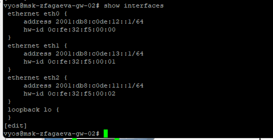{ #fig:013 width=70% height=70% }

## Проверяю IPv6-соединение с PC3

{ #fig:014 width=70% height=70% }

## Проверяю IPv6-соединение с PC4

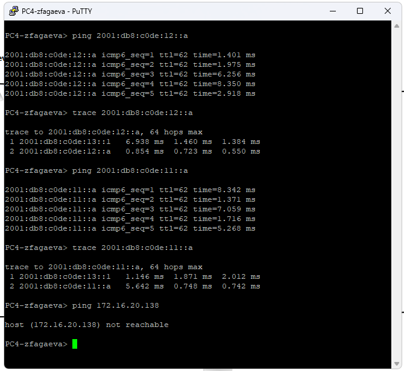{ #fig:015 width=70% height=70% }

## Проверяю работу сервера двойного стека

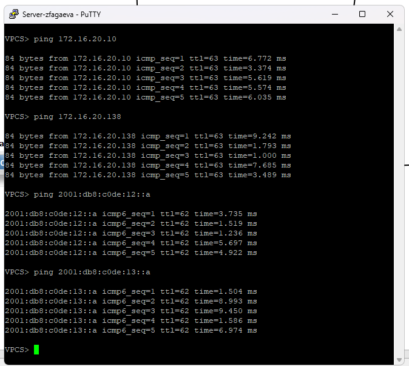{ #fig:016 width=70% height=70% }

## Анализирую ARP-трафик

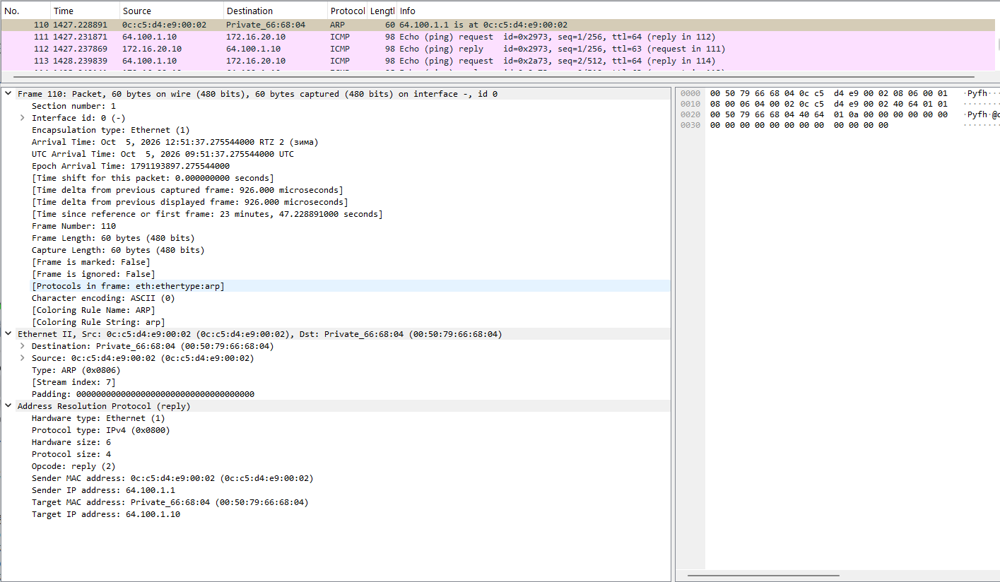{ #fig:017 width=70% height=70% }

## Анализирую ICMP-трафик IPv4

{ #fig:018 width=70% height=70% }

## Анализирую ICMPv6-трафик

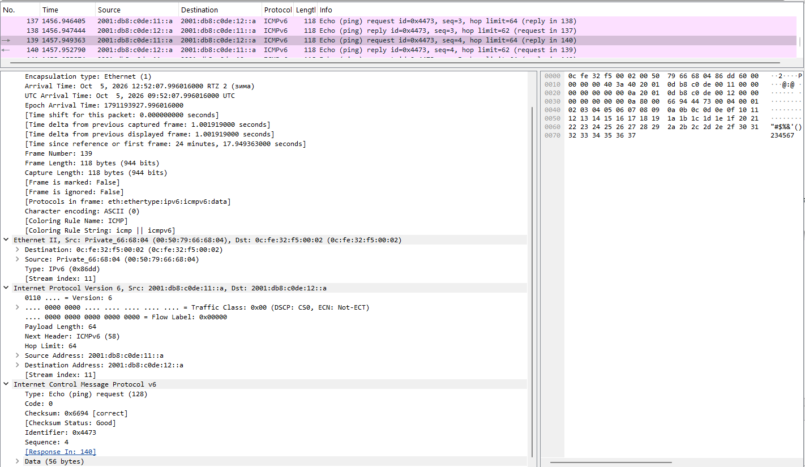{ #fig:019 width=70% height=70% }

# Самостоятельное задание

## Создаю топологию самостоятельного задания

{ #fig:020 width=70% height=70% }

## Настраиваю двойной стек на PC1

{ #fig:021 width=70% height=70% }

## Настраиваю двойной стек на PC2

{ #fig:022 width=70% height=70% }

## Настраиваю маршрутизатор VyOS

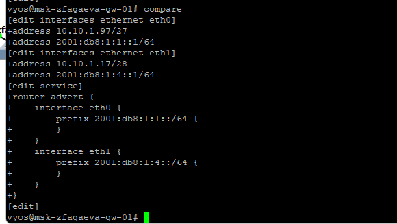{ #fig:023 width=70% height=70% }

## Проверяю интерфейсы маршрутизатора

{ #fig:024 width=70% height=70% }

## Проверяю соединение от PC1 к PC2

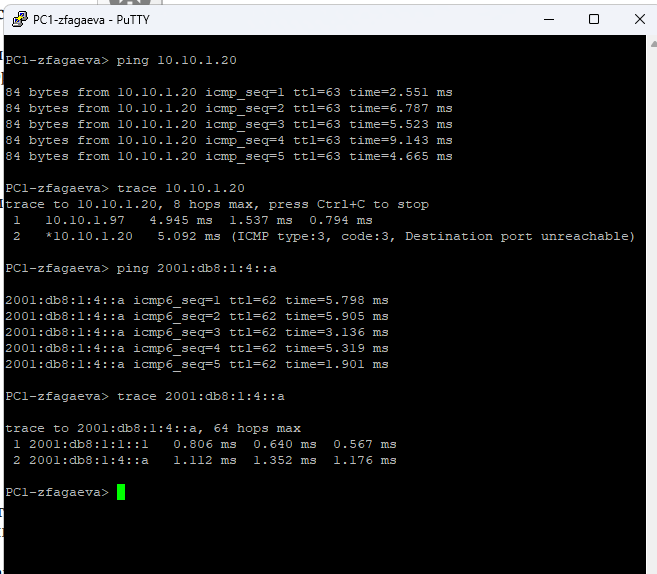{ #fig:025 width=70% height=70% }

## Проверяю соединение от PC2 к PC1

{ #fig:026 width=70% height=70% }

# Выводы по проделанной работе

## Вывод

В ходе лабораторной работы была построена сеть с двумя частями адресации: IPv4 и IPv6.

Была настроена IPv4-адресация на узлах PC1, PC2, сервере и маршрутизаторе FRR.

Была настроена IPv6-адресация на узлах PC3, PC4, сервере и маршрутизаторе VyOS.

В Wireshark были проанализированы пакеты ARP, ICMP и ICMPv6.

В самостоятельном задании были охарактеризованы подсети, составлена таблица адресации и проверена маршрутизация IPv4 и IPv6 между двумя локальными сетями.