---
## Author
author:
  name: Агаева Зейнаб Фуад кызы
  email: 1032245473@rudn.ru
  affiliation:
    - name: Российский университет дружбы народов
      country: Российская Федерация
      postal-code: 117198
      city: Москва
      address: ул. Миклухо-Маклая, д. 6

## Title
title: "Отчёт по лабораторной работе №4"
subtitle: "Адресация IPv4 и IPv6. Двойной стек"
license: "CC BY"
---

# Цель работы

Изучение принципов распределения и настройки адресного пространства на устройствах сети.

# Выполнение лабораторной работы

## Настройка двойного стека адресации IPv4 и IPv6 в локальной сети

### Построение топологии сети

Создаю в GNS3 новый проект и размещаю устройства в соответствии с заданной топологией. Для части сети с адресацией IPv4 использую маршрутизатор FRR `msk-zfagaeva-gw-01`, для части сети с IPv6 — маршрутизатор VyOS `msk-zfagaeva-gw-02`. В качестве оконечных устройств использую VPCS `PC1-zfagaeva`, `PC2-zfagaeva`, `PC3-zfagaeva`, `PC4-zfagaeva` и `Server-zfagaeva`. Для соединения устройств использую Ethernet-коммутаторы `msk-zfagaeva-sw-01`–`msk-zfagaeva-sw-05`.

Узлы `PC1-zfagaeva` и `PC2-zfagaeva` подключаю к маршрутизатору `msk-zfagaeva-gw-01` через отдельные коммутаторы. Узлы `PC3-zfagaeva` и `PC4-zfagaeva` аналогично подключаю к маршрутизатору `msk-zfagaeva-gw-02`. Сервер двойного стека `Server-zfagaeva` размещаю в общем Ethernet-сегменте, связанном с обоими маршрутизаторами. В результате получаю топологию, позволяющую отдельно проверить маршрутизацию IPv4 и IPv6, а серверу одновременно работать с обоими протоколами (см. рис. [@fig-001]).

{ #fig-001 width=70% }

### Настройка IPv4 на оконечных устройствах

На узле `PC1-zfagaeva` настраиваю IPv4-адрес `172.16.20.10/25` и шлюз по умолчанию `172.16.20.1`:

`ip 172.16.20.10/25 172.16.20.1`

После назначения адреса сохраняю конфигурацию командой `save`. Для проверки параметров выполняю команды `show ip` и `show ipv6`. В выводе `show ip` отображается IPv4-адрес `172.16.20.10/25` и шлюз `172.16.20.1`. Команда `show ipv6` показывает автоматически сформированный локальный IPv6-адрес области канала `fe80::/64`, при этом глобальный IPv6-адрес для данного узла не настраиваю (см. рис. [@fig-002]).

{ #fig-002 width=70% }

На узле `PC2-zfagaeva` задаю IPv4-адрес `172.16.20.138/25` и шлюз `172.16.20.129`:

`ip 172.16.20.138/25 172.16.20.129`

Конфигурацию сохраняю командой `save`, после чего проверяю её командами `show ip` и `show ipv6`. Узел получает требуемые параметры IPv4, а в IPv6 присутствует только локальный адрес области канала (см. рис. [@fig-003]).

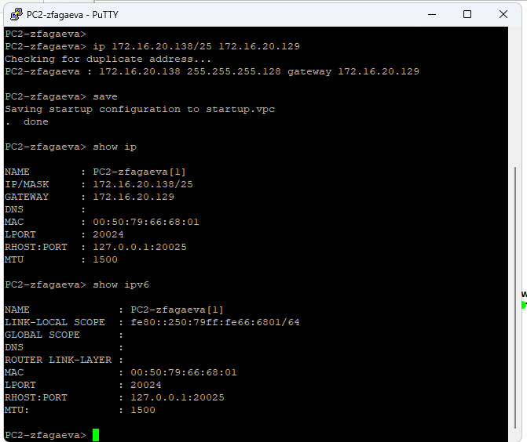{ #fig-003 width=70% }

На сервере двойного стека `Server-zfagaeva` настраиваю IPv4-адрес `64.100.1.10/24` со шлюзом `64.100.1.1` и сохраняю конфигурацию. Сервер расположен в отдельном сегменте `64.100.1.0/24`, доступ к которому из сетей `PC1-zfagaeva` и `PC2-zfagaeva` осуществляется через маршрутизатор FRR (см. рис. [@fig-004]).

{ #fig-004 width=70% }

### Настройка IPv4 на маршрутизаторе FRR

Перехожу в режим конфигурирования маршрутизатора FRR и изменяю его имя на `msk-zfagaeva-gw-01`. Далее назначаю IPv4-адреса трём Ethernet-интерфейсам:

- `eth0` — `172.16.20.1/25`;
- `eth1` — `172.16.20.129/25`;
- `eth2` — `64.100.1.1/24`.

Для каждого интерфейса выполняю команду `no shutdown`, после чего сохраняю конфигурацию командой `write memory`. В результате маршрутизатор получает по одному адресу в каждой из трёх непосредственно подключённых IPv4-сетей (см. рис. [@fig-005]).

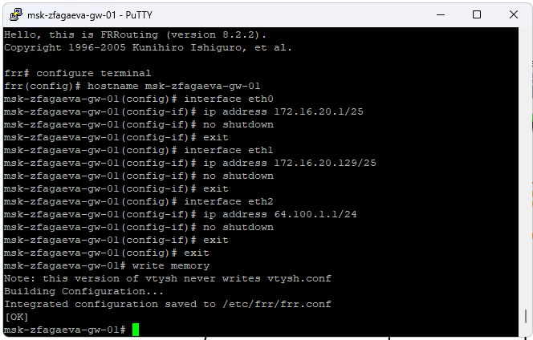{ #fig-005 width=70% }

Проверяю конфигурацию командами `show running-config` и `show interface brief`. В выводе отображаются назначенные адреса `172.16.20.1/25`, `172.16.20.129/25` и `64.100.1.1/24`, а задействованные интерфейсы находятся в рабочем состоянии. Следовательно, маршрутизатор готов выполнять пересылку IPv4-пакетов между подключёнными сетями (см. рис. [@fig-006]).

{ #fig-006 width=70% }

### Проверка подключения по IPv4

С узла `PC1-zfagaeva` проверяю доступность узла `PC2-zfagaeva` командой:

`ping 172.16.20.138`

Эхо-ответы успешно поступают от `172.16.20.138`. Значение `TTL=63` показывает прохождение пакетов через маршрутизатор. Командой `trace 172.16.20.138` дополнительно проверяю маршрут: первым переходом является шлюз `172.16.20.1`, после которого достигается конечный узел `172.16.20.138`.

После этого проверяю сервер командой `ping 64.100.1.10`. Ответы также поступают успешно. Трассировка до сервера проходит через шлюз `172.16.20.1`, что подтверждает корректную маршрутизацию между сетью `172.16.20.0/25` и сетью `64.100.1.0/24` (см. рис. [@fig-007]).

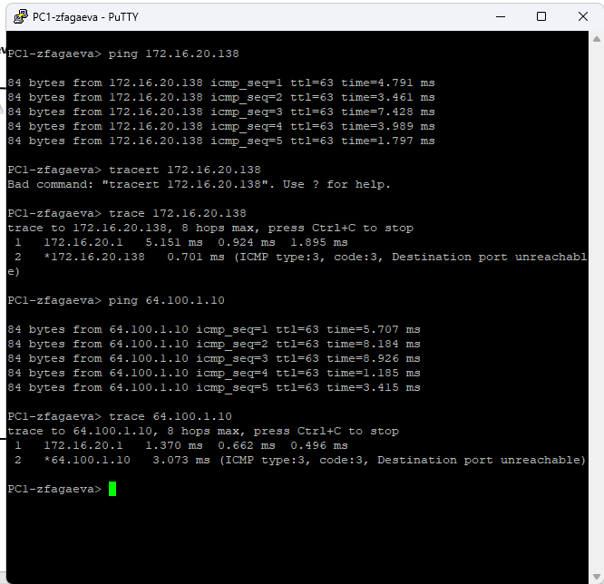{ #fig-007 width=70% }

Аналогичную проверку выполняю с `PC2-zfagaeva`. Узел успешно обменивается ICMP-пакетами с `PC1-zfagaeva` по адресу `172.16.20.10` и с сервером по адресу `64.100.1.10`. При трассировке первым переходом является шлюз `172.16.20.129`. Это подтверждает корректную маршрутизацию для сети `172.16.20.128/25` (см. рис. [@fig-008]).

{ #fig-008 width=70% }

### Настройка IPv6 на оконечных устройствах

На узле `PC3-zfagaeva` назначаю глобальный IPv6-адрес:

`ip 2001:db8:c0de:12::a/64`

Сохраняю конфигурацию командой `save`. С помощью `show ip` убеждаюсь, что IPv4-адрес на данном узле не настроен. Команда `show ipv6` показывает глобальный IPv6-адрес `2001:db8:c0de:12::a/64` и автоматически сформированный link-local адрес из диапазона `fe80::/64` (см. рис. [@fig-009]).

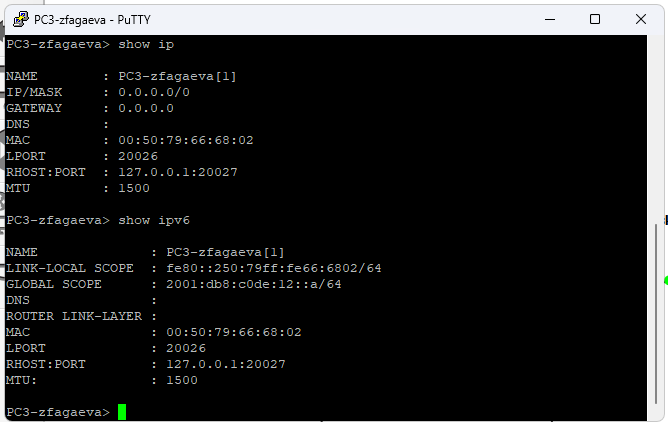{ #fig-009 width=70% }

На `PC4-zfagaeva` аналогично назначаю адрес:

`ip 2001:db8:c0de:13::a/64`

После сохранения конфигурации проверяю параметры командами `show ip` и `show ipv6`. Глобальный адрес узла принадлежит сети `2001:db8:c0de:13::/64`, а IPv4 на устройстве не используется (см. рис. [@fig-010]).

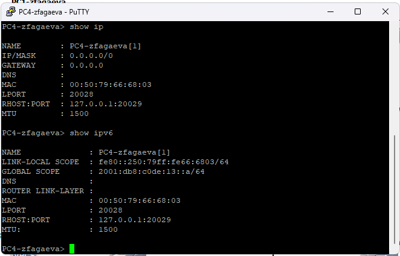{ #fig-010 width=70% }

На `Server-zfagaeva`, уже имеющем IPv4-адрес `64.100.1.10/24`, дополнительно назначаю IPv6-адрес:

`ip 2001:db8:c0de:11::a/64`

После настройки команда `show ip` отображает IPv4-параметры сервера, а `show ipv6` — глобальный адрес `2001:db8:c0de:11::a/64`. Сервер одновременно использует IPv4 и IPv6, то есть работает в режиме двойного стека (см. рис. [@fig-011]).

{ #fig-011 width=70% }

### Настройка IPv6 на маршрутизаторе VyOS

На маршрутизаторе VyOS задаю имя `msk-zfagaeva-gw-02` и настраиваю IPv6-адреса Ethernet-интерфейсов:

- `eth0` — `2001:db8:c0de:12::1/64`;
- `eth1` — `2001:db8:c0de:13::1/64`;
- `eth2` — `2001:db8:c0de:11::1/64`.

Для каждого интерфейса также настраиваю отправку Router Advertisement и указываю соответствующий префикс `/64`. Изменения проверяю командой `compare`, после чего применяю их командами `commit` и `save` (см. рис. [@fig-012]).

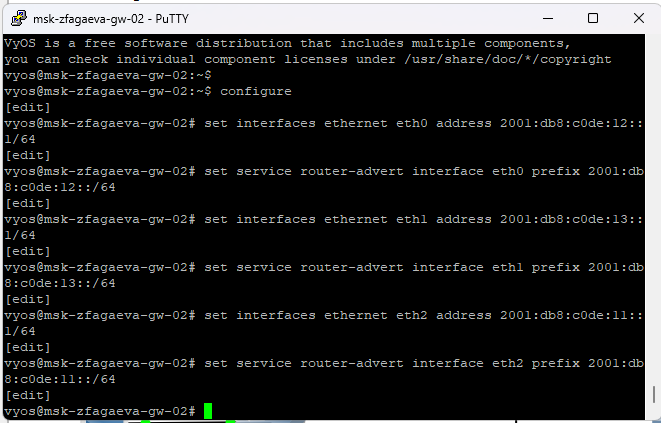{ #fig-012 width=70% }

Командой `show interfaces` проверяю назначенные адреса. В конфигурации присутствуют `2001:db8:c0de:12::1/64` на `eth0`, `2001:db8:c0de:13::1/64` на `eth1` и `2001:db8:c0de:11::1/64` на `eth2`. Маршрутизатор имеет непосредственное подключение ко всем трём IPv6-сетям и может маршрутизировать трафик между ними (см. рис. [@fig-013]).

{ #fig-013 width=70% }

### Проверка подключения по IPv6

С узла `PC3-zfagaeva` проверяю соединение с `PC4-zfagaeva`, отправляя ICMPv6 Echo Request на адрес `2001:db8:c0de:13::a`. Ответы поступают успешно. Трассировка показывает прохождение пакетов через маршрутизатор `msk-zfagaeva-gw-02`.

Также выполняю `ping` адреса сервера `2001:db8:c0de:11::a`. Сервер отвечает на запросы, что подтверждает корректную IPv6-маршрутизацию между подсетями. При попытке обратиться к IPv4-адресу с узла, настроенного только для IPv6, соединение установить невозможно (см. рис. [@fig-014]).

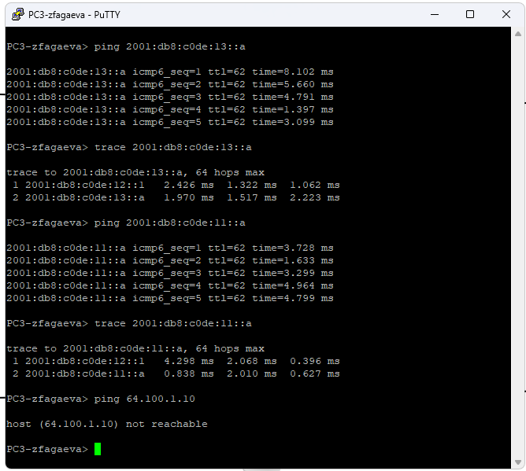{ #fig-014 width=70% }

С `PC4-zfagaeva` проверяю доступность `PC3-zfagaeva` и сервера по их IPv6-адресам. Обмен ICMPv6-пакетами проходит успешно, а трассировка показывает промежуточный переход через маршрутизатор VyOS. Попытка обращения к узлу IPv4 по адресу `172.16.20.138` завершается сообщением о недоступности, поскольку `PC4-zfagaeva` не имеет настроенного IPv4-адреса и не используется механизм преобразования между IPv4 и IPv6 (см. рис. [@fig-015]).

{ #fig-015 width=70% }

С сервера двойного стека выполняю проверки в обоих направлениях. По IPv4 сервер успешно обращается к узлам сетей `172.16.20.0/25` и `172.16.20.128/25`, а по IPv6 — к узлам сетей `2001:db8:c0de:12::/64` и `2001:db8:c0de:13::/64`. Следовательно, `Server-zfagaeva` является единственным оконечным устройством в данной топологии, способным непосредственно взаимодействовать как с IPv4-, так и с IPv6-частью сети (см. рис. [@fig-016]).

{ #fig-016 width=70% }

### Анализ ARP, ICMP и ICMPv6 в Wireshark

На соединении `Server-zfagaeva` с ближайшим коммутатором запускаю захват трафика в Wireshark. В захвате присутствуют пакеты ARP, необходимые для сопоставления IPv4-адресов с MAC-адресами.

В выбранном ARP-пакете содержится ответ, сообщающий, что IPv4-адрес `64.100.1.1` соответствует MAC-адресу `0c:c5:d4:e9:00:02`. Получателем является сервер `64.100.1.10` с MAC-адресом `00:50:79:66:68:04`. Из ARP-пакета можно определить тип операции, IPv4-адрес отправителя, его MAC-адрес, а также адреса узла-получателя. ARP используется только для IPv4 и позволяет устройствам одного Ethernet-сегмента определить канальный адрес следующего узла (см. рис. [@fig-017]).

{ #fig-017 width=70% }

Далее анализирую ICMP-трафик IPv4. В захвате присутствует ICMP Echo Request от сервера `64.100.1.10` к узлу `172.16.20.10` и соответствующий Echo Reply. В заголовке IPv4 можно определить адрес источника `64.100.1.10`, адрес назначения `172.16.20.10`, значение `TTL`, используемый протокол ICMP и другие служебные поля. В заголовке ICMP отображаются тип сообщения `Echo (ping) request`, код `0`, идентификатор и порядковый номер пакета. По паре Echo Request/Echo Reply можно определить успешность соединения и время обмена между узлами (см. рис. [@fig-018]).

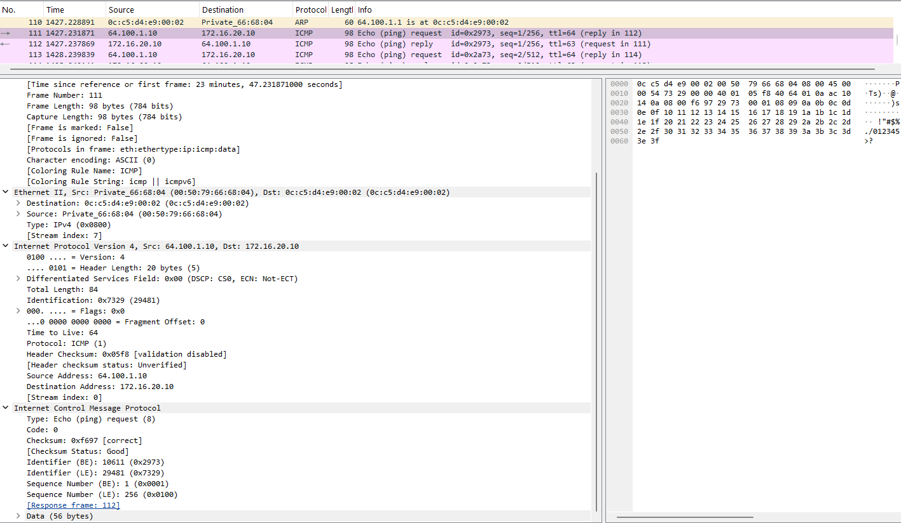{ #fig-018 width=70% }

При анализе ICMPv6 наблюдаю Echo Request и Echo Reply между сервером `2001:db8:c0de:11::a` и узлом `2001:db8:c0de:12::a`. В заголовке IPv6 можно определить адрес источника и назначения, значение `Hop Limit`, поле `Next Header`, указывающее на ICMPv6, а также длину полезной нагрузки. В заголовке ICMPv6 отображаются тип `Echo (ping) request`, код, контрольная сумма, идентификатор и номер последовательности.

В отличие от IPv4, IPv6 не использует ARP. Функции обнаружения соседей выполняются сообщениями ICMPv6 протокола Neighbor Discovery. Захват показывает, что сервер двойного стека способен одновременно формировать обычный ICMP-трафик для IPv4 и ICMPv6-трафик для IPv6 (см. рис. [@fig-019]).

{ #fig-019 width=70% }

## Задание для самостоятельного выполнения

### Характеристика заданных подсетей

Для первой локальной сети задан IPv4-префикс `10.10.1.96/27`. Префиксу `/27` соответствует маска `255.255.255.224`. Размер подсети составляет 32 IPv4-адреса:

- адрес сети — `10.10.1.96`;
- диапазон всех адресов — `10.10.1.96`–`10.10.1.127`;
- диапазон адресов узлов — `10.10.1.97`–`10.10.1.126`;
- широковещательный адрес — `10.10.1.127`;
- количество доступных адресов узлов — 30.

Для этой же локальной сети задан IPv6-префикс `2001:db8:1:1::/64`. Адрес сети имеет вид `2001:db8:1:1::`, а адресное пространство содержит все адреса от `2001:db8:1:1:0000:0000:0000:0000` до `2001:db8:1:1:ffff:ffff:ffff:ffff`. В IPv6 широковещательные адреса не используются.

Для второй локальной сети задан IPv4-префикс `10.10.1.16/28`. Префиксу `/28` соответствует маска `255.255.255.240`. Размер подсети составляет 16 IPv4-адресов:

- адрес сети — `10.10.1.16`;
- диапазон всех адресов — `10.10.1.16`–`10.10.1.31`;
- диапазон адресов узлов — `10.10.1.17`–`10.10.1.30`;
- широковещательный адрес — `10.10.1.31`;
- количество доступных адресов узлов — 14.

IPv6-префикс второй сети — `2001:db8:1:4::/64`. В него входят адреса от `2001:db8:1:4:0000:0000:0000:0000` до `2001:db8:1:4:ffff:ffff:ffff:ffff`.

В соответствии с условием на интерфейсах маршрутизатора выбираю наименьшие доступные адреса IPv4: `10.10.1.97` в первой подсети и `10.10.1.17` во второй. Для IPv6-интерфейсов использую адрес `::1` соответствующего префикса.

### Таблица адресации

| Устройство | Интерфейс | IPv4-адрес | IPv6-адрес | Шлюз |
|---|---|---|---|---|
| `msk-zfagaeva-gw-01` | `eth0` | `10.10.1.97/27` | `2001:db8:1:1::1/64` | — |
| `msk-zfagaeva-gw-01` | `eth1` | `10.10.1.17/28` | `2001:db8:1:4::1/64` | — |
| `PC1-zfagaeva` | `NIC` | `10.10.1.100/27` | `2001:db8:1:1::a/64` | `10.10.1.97` |
| `PC2-zfagaeva` | `NIC` | `10.10.1.20/28` | `2001:db8:1:4::a/64` | `10.10.1.17` |

### Построение топологии самостоятельного задания

Создаю топологию из двух локальных сетей, соединённых маршрутизатором VyOS `msk-zfagaeva-gw-01`. В первой сети размещаю `PC1-zfagaeva` и коммутатор `msk-zfagaeva-sw-01`, во второй — `PC2-zfagaeva` и `msk-zfagaeva-sw-02`. Интерфейс `eth0` маршрутизатора подключаю к первой подсети, а `eth1` — ко второй (см. рис. [@fig-020]).

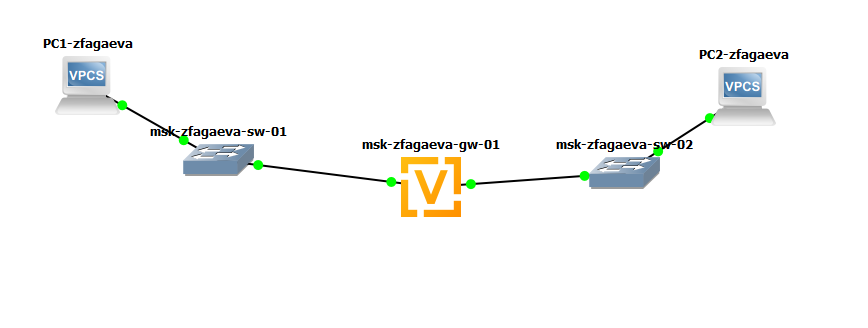{ #fig-020 width=70% }

### Настройка адресации PC1 и PC2

На `PC1-zfagaeva` назначаю IPv4-адрес `10.10.1.100/27` со шлюзом `10.10.1.97` и IPv6-адрес `2001:db8:1:1::a/64`. С помощью команд `show ip` и `show ipv6` проверяю установленные параметры. Узел одновременно имеет глобальные адреса IPv4 и IPv6 и может использовать оба протокола (см. рис. [@fig-021]).

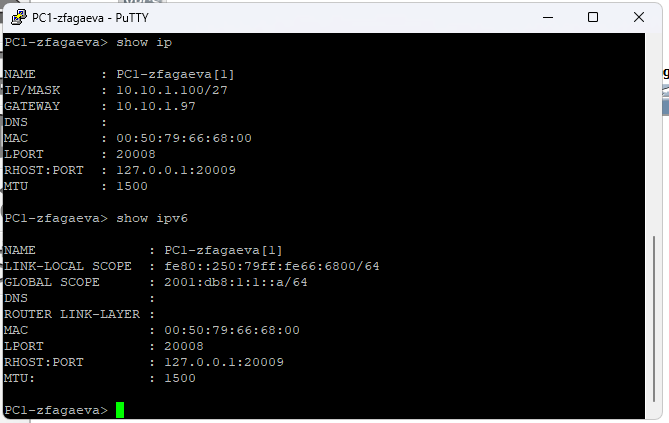{ #fig-021 width=70% }

На `PC2-zfagaeva` назначаю IPv4-адрес `10.10.1.20/28` со шлюзом `10.10.1.17` и IPv6-адрес `2001:db8:1:4::a/64`. Проверяю конфигурацию командами `show ip` и `show ipv6` (см. рис. [@fig-022]).

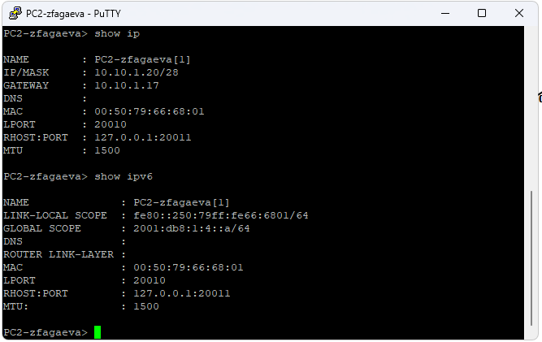{ #fig-022 width=70% }

### Настройка маршрутизатора VyOS

На маршрутизаторе `msk-zfagaeva-gw-01` назначаю на интерфейс `eth0` наименьший допустимый IPv4-адрес первой подсети `10.10.1.97/27` и IPv6-адрес `2001:db8:1:1::1/64`.

На интерфейс `eth1` назначаю наименьший допустимый адрес второй IPv4-подсети `10.10.1.17/28` и IPv6-адрес `2001:db8:1:4::1/64`.

Дополнительно настраиваю Router Advertisement для интерфейсов `eth0` и `eth1`, указывая префиксы `2001:db8:1:1::/64` и `2001:db8:1:4::/64`. Командой `compare` проверяю подготовленные изменения перед их применением (см. рис. [@fig-023]).

{ #fig-023 width=70% }

Командой `show interfaces` проверяю результат настройки. Интерфейс `eth0` содержит адреса `10.10.1.97/27` и `2001:db8:1:1::1/64`, а `eth1` — `10.10.1.17/28` и `2001:db8:1:4::1/64`. Следовательно, маршрутизатор непосредственно подключён к обеим сетям по IPv4 и IPv6 (см. рис. [@fig-024]).

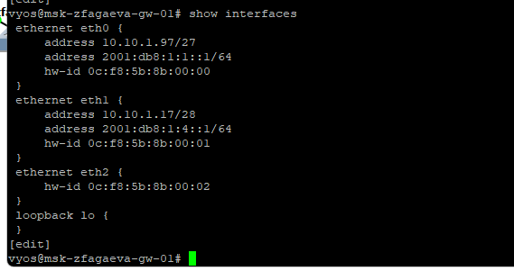{ #fig-024 width=70% }

### Проверка подключения между подсетями

С `PC1-zfagaeva` выполняю `ping 10.10.1.20`. Узел `PC2-zfagaeva` успешно отвечает, потерь пакетов не наблюдается. Значение `TTL=63` подтверждает прохождение IPv4-пакетов через маршрутизатор.

Командой `trace 10.10.1.20` определяю путь до узла второй подсети. Первым переходом является маршрутизатор `10.10.1.97`, вторым — конечный адрес `10.10.1.20`.

Затем проверяю IPv6-соединение командой `ping 2001:db8:1:4::a`. Ответы от `PC2-zfagaeva` успешно поступают. Трассировка `trace 2001:db8:1:4::a` показывает первым переходом IPv6-адрес маршрутизатора `2001:db8:1:1::1`, а вторым — конечный узел `2001:db8:1:4::a`. Таким образом, маршрутизация между двумя подсетями работает для обоих протоколов (см. рис. [@fig-025]).

{ #fig-025 width=70% }

В обратном направлении с `PC2-zfagaeva` выполняю `ping 10.10.1.100`. Узел `PC1-zfagaeva` успешно отвечает. Команда `trace 10.10.1.100` показывает прохождение пакетов через шлюз `10.10.1.17`.

Далее выполняю `ping 2001:db8:1:1::a` и получаю успешные ICMPv6 Echo Reply от `PC1-zfagaeva`. При трассировке первым переходом является интерфейс маршрутизатора `2001:db8:1:4::1`, после чего пакет достигает `2001:db8:1:1::a`.

Успешная двусторонняя проверка подтверждает корректность выбранной таблицы адресации, конфигурации интерфейсов VyOS и маршрутизации IPv4 и IPv6 между двумя локальными подсетями (см. рис. [@fig-026]).

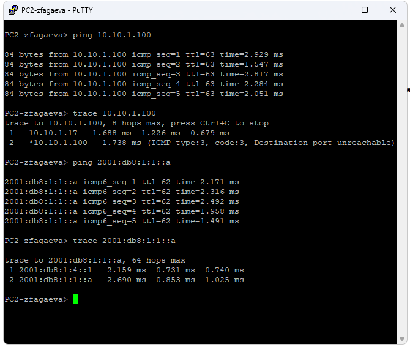{ #fig-026 width=70% }

# Вывод

В ходе лабораторной работы настроена адресация IPv4 и IPv6, выполнена маршрутизация между локальными подсетями и проверена доступность узлов с помощью команд `ping` и `trace`. На сервере настроен двойной стек IPv4/IPv6. Анализ трафика в Wireshark позволил рассмотреть работу протоколов ARP, ICMP и ICMPv6. Также самостоятельно выполнено разбиение адресного пространства на подсети и настроена маршрутизация IPv4 и IPv6 между ними.

# Список литературы

1. [GNS3. Официальная документация](https://docs.gns3.com/)

2. [FRRouting. Официальная документация](https://docs.frrouting.org/en/latest/)

3. [VyOS. Настройка Ethernet-интерфейсов и IP-адресации](https://docs.vyos.io/en/1.5/configuration/interfaces/ethernet.html)

4. [VyOS. Настройка IPv6 Router Advertisement](https://docs.vyos.io/en/1.5/configuration/service/router-advert.html)

5. [Wireshark. Руководство пользователя](https://www.wireshark.org/docs/wsug_html/)

6. [RFC 8200. Internet Protocol, Version 6 (IPv6) Specification](https://www.rfc-editor.org/rfc/rfc8200.html)

7. [RFC 826. Address Resolution Protocol (ARP)](https://www.rfc-editor.org/rfc/rfc826.html)

8. [RFC 792. Internet Control Message Protocol (ICMP)](https://www.rfc-editor.org/rfc/rfc792.html)

9. [RFC 4861. Neighbor Discovery for IP version 6 (IPv6)](https://www.rfc-editor.org/rfc/rfc4861.html)

10. [RFC 4291. IP Version 6 Addressing Architecture](https://www.rfc-editor.org/rfc/rfc4291.html)