---
## Author
author:
  name: Агаева Зейнаб Фуад кызы
  email: 1032245473@rudn.ru
  affiliation:
    - name: Российский университет дружбы народов
      country: Российская Федерация
      postal-code: 117198
      city: Москва
      address: ул. Миклухо-Маклая, д. 6

## Title
title: "Отчёт по лабораторной работе №5"
subtitle: "Адресация IPv4 и IPv6. Настройка DHCP"
license: "CC BY"
---

# Цель работы

Получение навыков настройки службы DHCP на сетевом оборудовании для распределения адресов IPv4 и IPv6.

# Выполнение лабораторной работы

## Адресация IPv4 и IPv6. Настройка DHCP

### Построение топологии сети

Создаю проект в GNS3 и размещаю маршрутизатор VyOS `zfagaeva-gw-01`, коммутатор `zfagaeva-sw-01` и клиент VPCS `PC1-zfagaeva`. Соединяю устройства и включаю захват трафика между маршрутизатором и коммутатором для анализа DHCP-пакетов (см. рис. [@fig-001]).

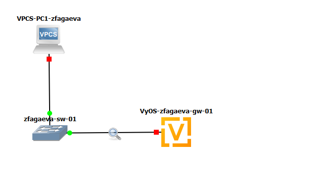{ #fig-001 width=70% }

### Настройка маршрутизатора VyOS

Перехожу в режим конфигурирования командой `configure`. Устанавливаю имя маршрутизатора `zfagaeva-gw-01`, домен `zfagaeva.net`, создаю пользователя `zfagaeva` и отключаю получение адреса по DHCP на интерфейсе `eth0` (см. рис. [@fig-002]).

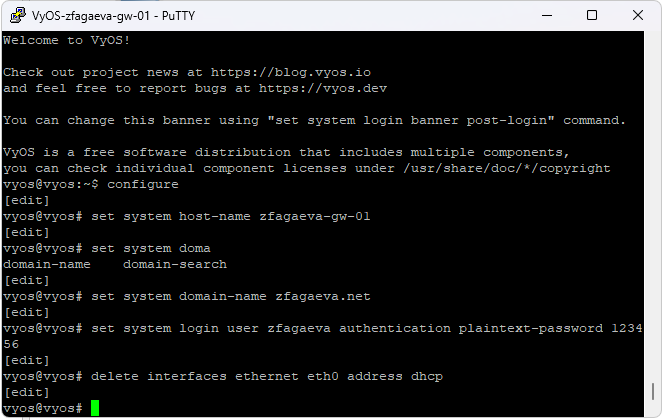{ #fig-002 width=70% }

Применяю настройки командами `commit` и `save`, вхожу под новым пользователем и удаляю стандартную учётную запись `vyos`. Повторно сохраняю конфигурацию (см. рис. [@fig-003]).

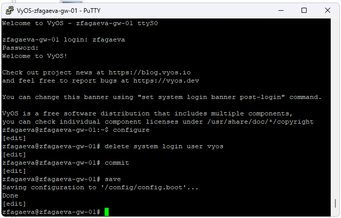{ #fig-003 width=70% }

### Настройка DHCP-сервера IPv4

Назначаю интерфейсу `eth0` адрес `10.0.0.1/24`:

`set interfaces ethernet eth0 address 10.0.0.1/24`

Создаю DHCP-сеть `zfagaeva` для подсети `10.0.0.0/24`. Задаю шлюз и DNS-сервер `10.0.0.1`, домен `zfagaeva.net` и диапазон выдаваемых адресов `10.0.0.2–10.0.0.253`. Применяю и сохраняю настройки (см. рис. [@fig-004]).

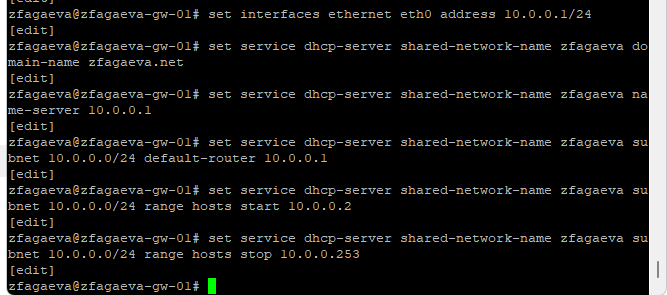{ #fig-004 width=70% }

Проверяю состояние DHCP-сервера командами:

`show dhcp server statistics`

`show dhcp server leases`

До подключения клиента сервер располагает 252 свободными адресами, записи об аренде отсутствуют (см. рис. [@fig-005]).

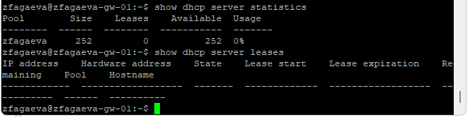{ #fig-005 width=70% }

### Получение IPv4-адреса на PC1

На устройстве `PC1-zfagaeva` запускаю получение адреса с отображением DHCP-сообщений:

`ip dhcp -d`

Клиент получает адрес `10.0.0.2/24`, шлюз `10.0.0.1`, DNS-сервер `10.0.0.1` и домен `zfagaeva.net`. В сообщении `DHCP ACK` указан срок аренды 86400 секунд. Сохраняю настройки командой `save` (см. рис. [@fig-006]).

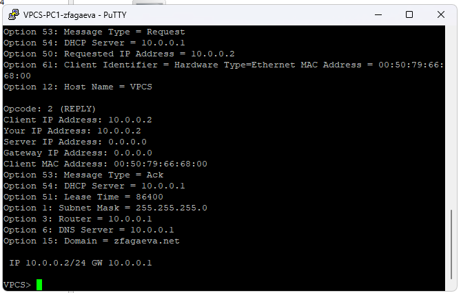{ #fig-006 width=70% }

Проверяю параметры командой `show ip` и доступность маршрутизатора:

`ping 10.0.0.1 -c 2`

Получаю два ответа без потерь пакетов, что подтверждает работоспособность соединения (см. рис. [@fig-007]).

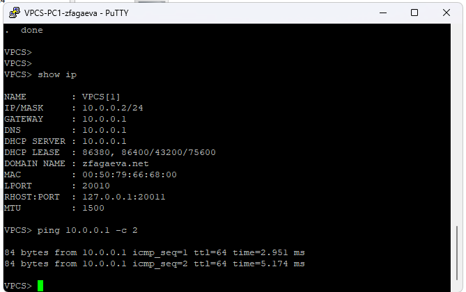{ #fig-007 width=70% }

Повторно проверяю статистику DHCP-сервера. Количество свободных адресов уменьшается до 251, а в таблице аренды появляется адрес `10.0.0.2` со статусом `active` и MAC-адресом клиента `00:50:79:66:68:00` (см. рис. [@fig-008]).

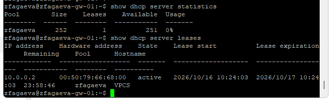{ #fig-008 width=70% }

Просматриваю журнал DHCP-сервера командой:

`show log | grep dhcp`

В журнале присутствуют сообщения `DHCPDISCOVER`, `DHCPREQUEST` и `DHCPACK`, подтверждающие обработку запроса и выдачу адреса клиенту (см. рис. [@fig-009]).

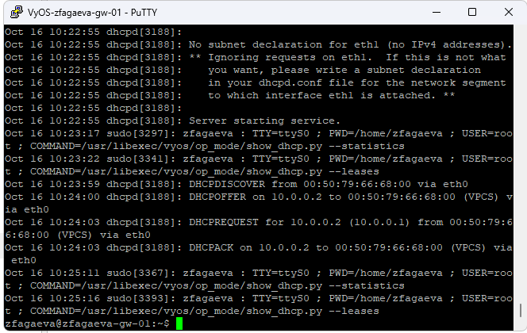{ #fig-009 width=70% }

### Анализ DHCPv4-трафика

Открываю захват в Wireshark. Сначала рассматриваю сообщение `DHCP Discover`, отправленное клиентом с адреса `0.0.0.0` на широковещательный адрес `255.255.255.255` для поиска DHCP-сервера. Передача выполняется по UDP с порта 68 на порт 67 (см. рис. [@fig-010]).

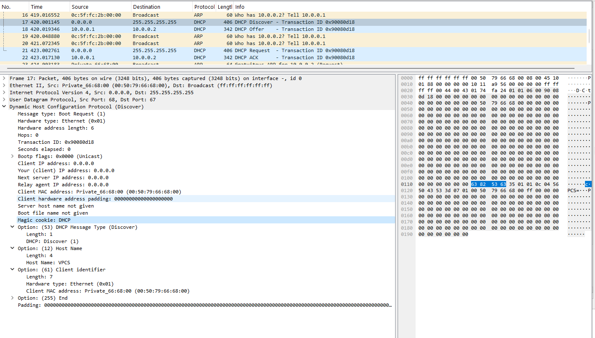{ #fig-010 width=70% }

В ответ сервер отправляет `DHCP Offer` с предложением адреса `10.0.0.2`, маски `255.255.255.0`, шлюза и DNS-сервера `10.0.0.1`, а также срока аренды 86400 секунд (см. рис. [@fig-011]).

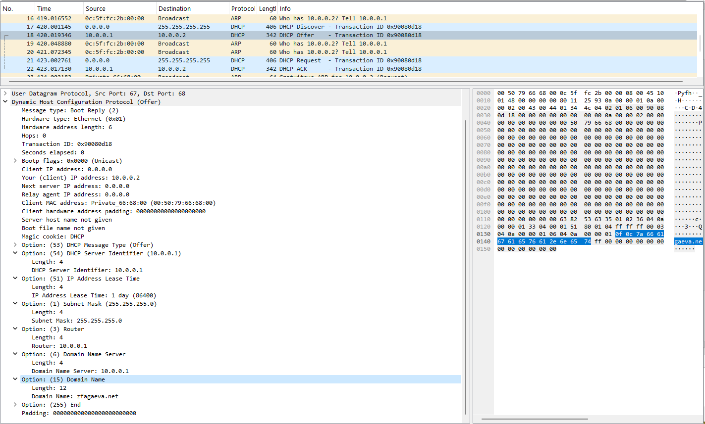{ #fig-011 width=70% }

Затем клиент отправляет `DHCP Request`, подтверждая запрос адреса `10.0.0.2` у сервера `10.0.0.1`. В пакете присутствуют опции Requested IP Address и DHCP Server Identifier (см. рис. [@fig-012]).

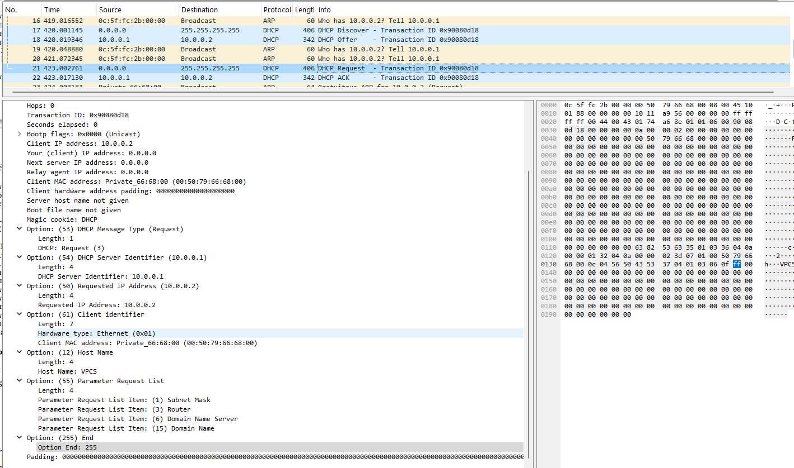{ #fig-012 width=70% }

Сервер завершает обмен сообщением `DHCP ACK`, подтверждая назначение IPv4-адреса. Все четыре сообщения относятся к одной DHCP-транзакции, что подтверждает корректное выполнение процедуры DORA (см. рис. [@fig-013]).

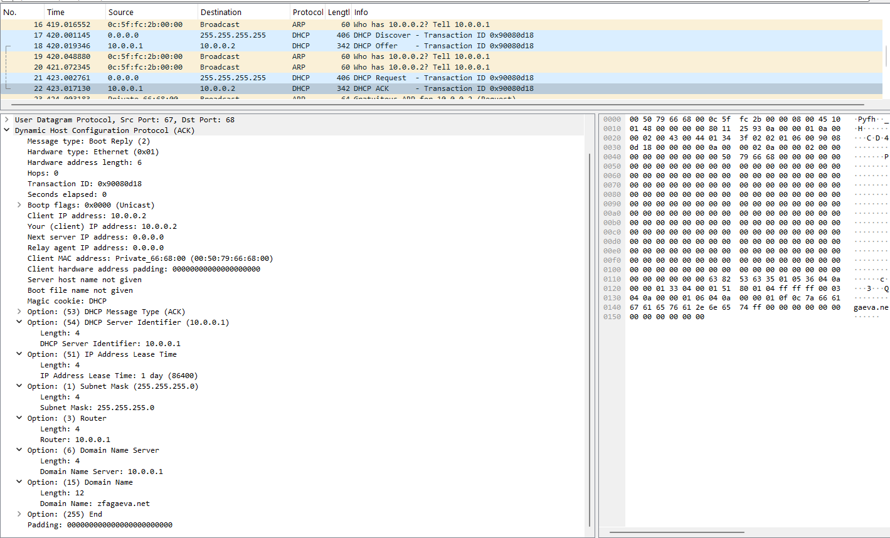{ #fig-013 width=70% }

### Построение топологии для DHCPv6

Дополняю сеть двумя коммутаторами `zfagaeva-sw-02` и `zfagaeva-sw-03`, подключёнными к интерфейсам `eth1` и `eth2` маршрутизатора. К ним подключаю узлы AlmaLinux и Alpine Linux для исследования двух режимов DHCPv6.

Для Stateless DHCPv6 использую подсеть `2000::/64`, для Stateful DHCPv6 — `2001::/64`. Включаю захват трафика на соединениях с маршрутизатором (см. рис. [@fig-014]).

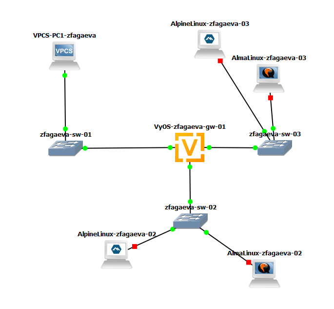{ #fig-014 width=70% }

### Настройка IPv6 на маршрутизаторе

Назначаю IPv6-адреса интерфейсам маршрутизатора:

`set interfaces ethernet eth1 address 2000::1/64`

`set interfaces ethernet eth2 address 2001::1/64`

Проверяю конфигурацию командой `show interfaces`, затем выполняю `commit` и `save` (см. рис. [@fig-015]).

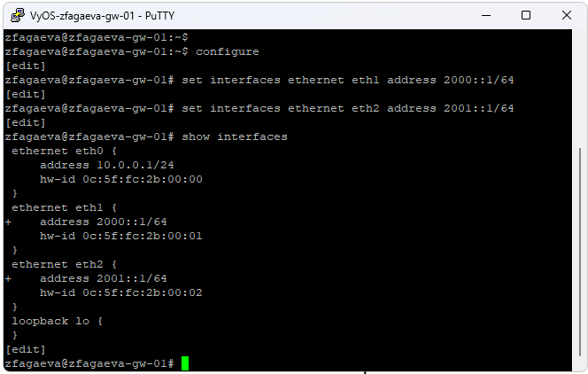{ #fig-015 width=70% }

### Настройка Stateless DHCPv6

На интерфейсе `eth1` включаю объявления маршрутизатора с префиксом `2000::/64` и флагом `other-config-flag`:

`set service router-advert interface eth1 prefix 2000::/64`

`set service router-advert interface eth1 other-config-flag`

Создаю DHCPv6-сеть `zfagaeva-stateless`, указываю DNS-сервер `2000::1` и домен поиска `zfagaeva.net`. В данном режиме IPv6-адрес формируется с помощью SLAAC, а DHCPv6 передаёт дополнительные параметры (см. рис. [@fig-016]).

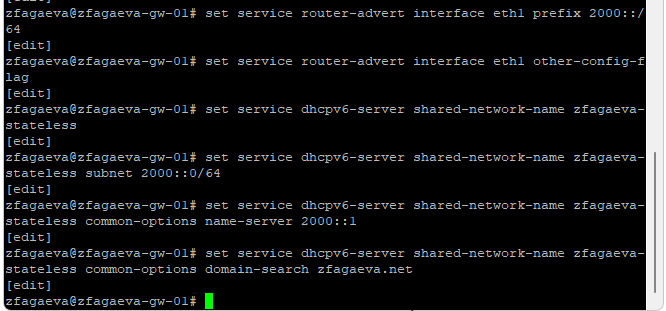{ #fig-016 width=70% }

Проверяю конфигурацию командой `run show configuration`. Убеждаюсь, что настройки DHCPv4 сохранились и добавлена разделяемая сеть `zfagaeva-stateless` (см. рис. [@fig-017]).

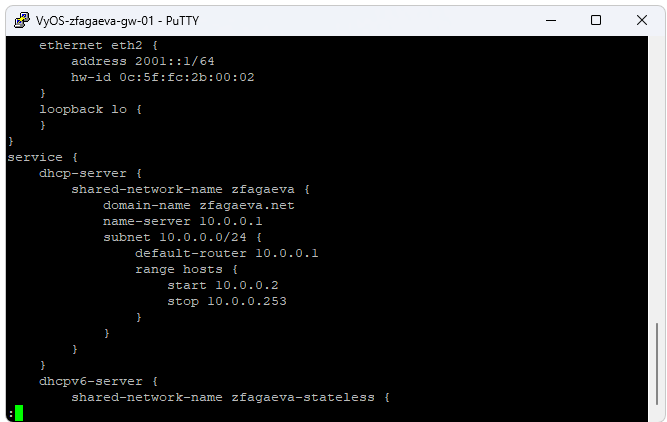{ #fig-017 width=70% }

В конфигурации проверяю параметры `name-server 2000::1`, `domain-search zfagaeva.net`, префикс `2000::/64` и флаг `other-config-flag` на интерфейсе `eth1` (см. рис. [@fig-018]).

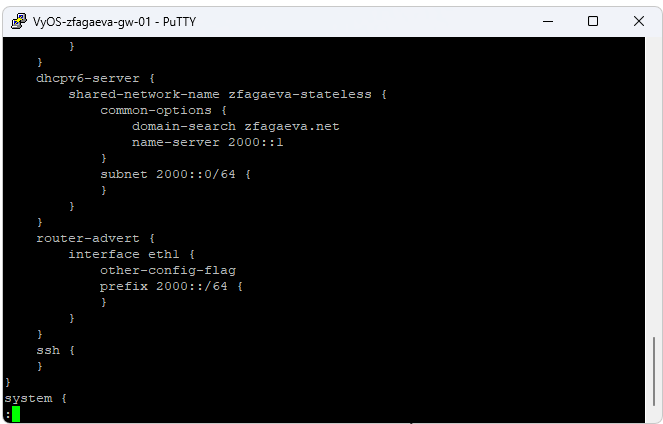{ #fig-018 width=70% }

### Проверка Stateless DHCPv6 на клиентах

На `AlpineLinux-zfagaeva-02` выполняю команды:

`ip address`

`ip -6 route show`

`ping 2000::1 -c 2`

`cat /etc/resolv.conf`

Узел получает глобальный IPv6-адрес из сети `2000::/64` через SLAAC и успешно обменивается ICMPv6-пакетами с маршрутизатором. При этом в DNS-конфигурации остаётся сервер `10.0.2.3` (см. рис. [@fig-019]).

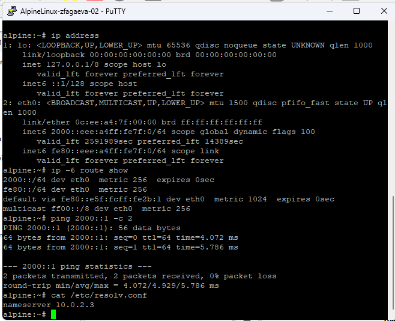{ #fig-019 width=70% }

На `AlmaLinux-zfagaeva-02` выполняю аналогичные проверки. Узел получает IPv6-адрес из префикса `2000::/64`, маршрут по умолчанию и параметры DNS: сервер `2000::1` и домен `zfagaeva.net`. Проверка `ping 2000::1 -c 2` проходит успешно (см. рис. [@fig-020]).

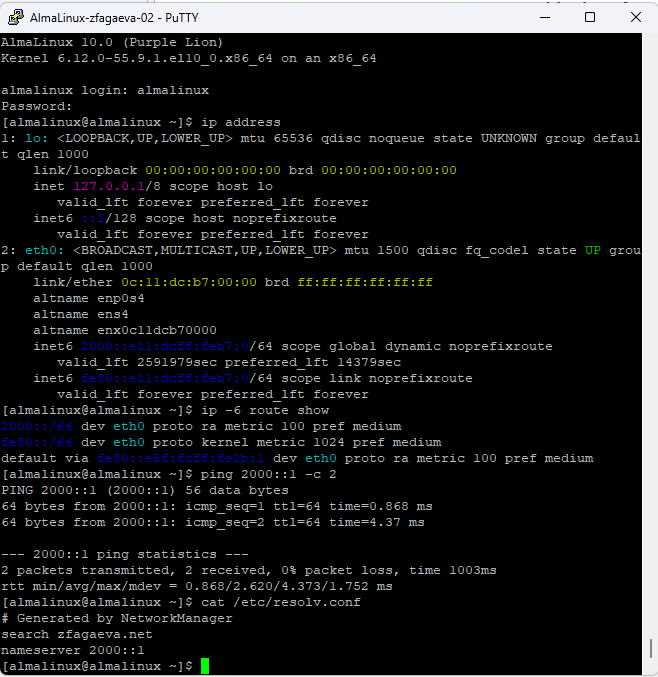{ #fig-020 width=70% }

На маршрутизаторе выполняю:

`run show dhcpv6 server leases`

Таблица аренды остаётся пустой, поскольку при Stateless DHCPv6 адреса формируются клиентами через SLAAC, а DHCPv6-сервер не ведёт их учёт (см. рис. [@fig-021]).

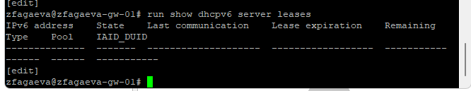{ #fig-021 width=70% }

### Анализ Stateless DHCPv6 в Wireshark

В Wireshark рассматриваю пакет `Information-request`, отправленный клиентом на многоадресный адрес `ff02::1:2` через UDP-порт 547. Клиент запрашивает дополнительные параметры, включая DNS-сервер и домен поиска, без запроса IPv6-адреса (см. рис. [@fig-022]).

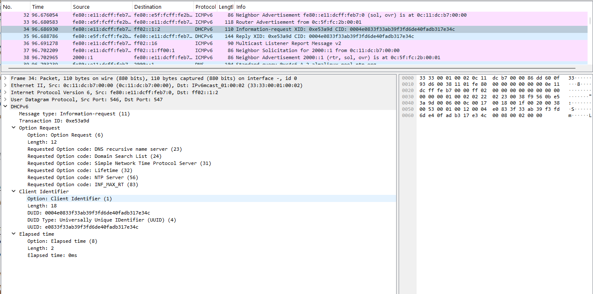{ #fig-022 width=70% }

В ответном пакете `DHCPv6 Reply` сервер передаёт адрес DNS-сервера `2000::1` и домен поиска `zfagaeva.net`. Отсутствие назначаемого адреса подтверждает использование режима Stateless DHCPv6 (см. рис. [@fig-023]).

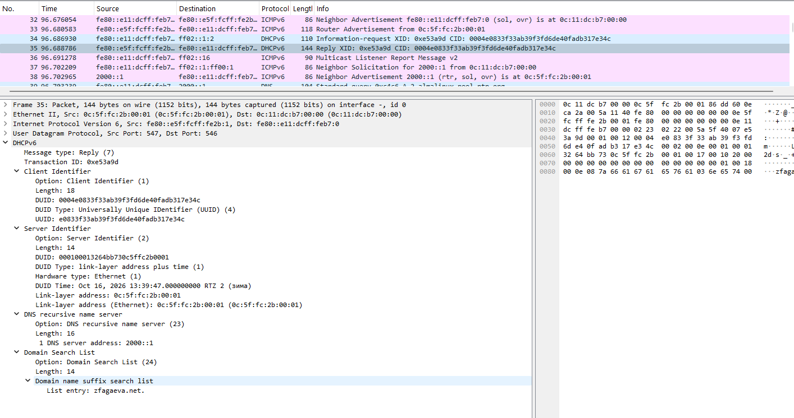{ #fig-023 width=70% }

### Настройка Stateful DHCPv6

На интерфейсе `eth2` включаю флаг `managed-flag`:

`set service router-advert interface eth2 managed-flag`

Создаю разделяемую сеть `zfagaeva-stateful` для подсети `2001::/64`. Указываю DNS-сервер `2001::1`, домен `zfagaeva.net` и диапазон выдаваемых адресов `2001::100–2001::199`.

В этом режиме DHCPv6-сервер самостоятельно назначает IPv6-адреса и отслеживает их аренду. Применяю и сохраняю конфигурацию (см. рис. [@fig-024]).

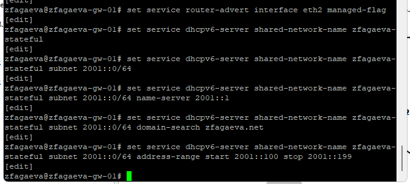{ #fig-024 width=70% }

### Проверка Stateful DHCPv6 на клиентах

На `AlpineLinux-zfagaeva-03` проверяю интерфейс и маршруты командами `ip address` и `ip -6 route show`. Первоначально отображается только локальный IPv6-адрес области канала.

Запускаю DHCPv6-клиент:

`udhcpc6 -i eth0`

В выводе появляются сообщения `sending discover`, `sending select` и `IPv6 obtained, lease time 43200`, подтверждающие получение аренды сроком 12 часов (см. рис. [@fig-025]).

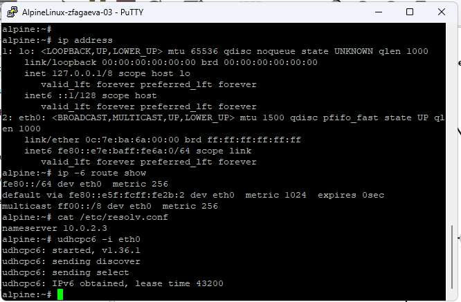{ #fig-025 width=70% }

Повторно проверяю интерфейс, маршруты и DNS. Глобальный IPv6-адрес в выводе `ip address` не отображается, однако `ping 2001::1 -c 2` проходит успешно. В `/etc/resolv.conf` присутствуют DNS-сервер `2001::1` и домен `zfagaeva.net` (см. рис. [@fig-026]).

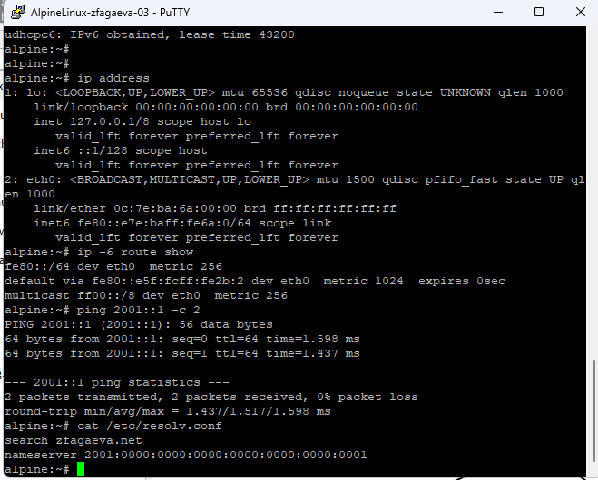{ #fig-026 width=70% }

На `AlmaLinux-zfagaeva-03` проверяю параметры интерфейса. Узел получает динамический IPv6-адрес `2001::199/128` и маршрут по умолчанию через маршрутизатор.

Проверка `ping 2001::1 -c 2` выполняется без потерь. В DNS-конфигурации отображаются сервер `2001::1` и домен `zfagaeva.net` (см. рис. [@fig-027]).

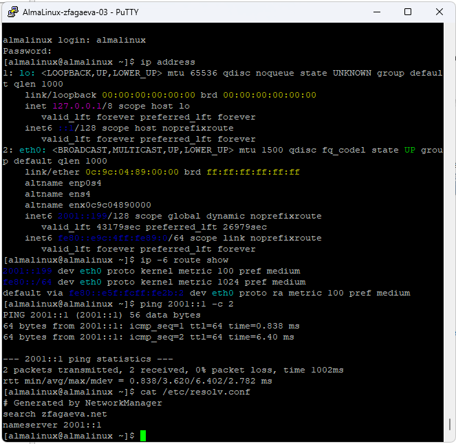{ #fig-027 width=70% }

На маршрутизаторе выполняю:

`run show dhcpv6 server leases`

В таблице отображаются две активные аренды IPv6-адресов: `2001::198` для Alpine Linux и `2001::199` для AlmaLinux. Для каждой записи указаны идентификатор клиента и срок аренды. Это подтверждает работу Stateful DHCPv6 (см. рис. [@fig-028]).

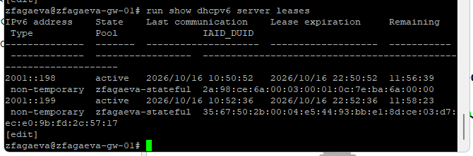{ #fig-028 width=70% }

### Анализ Stateful DHCPv6 в Wireshark

В захваченном трафике рассматриваю пакет `DHCPv6 Solicit`, отправленный клиентом для поиска DHCPv6-сервера. В пакете присутствует опция `IA_NA`, указывающая на необходимость назначения IPv6-адреса (см. рис. [@fig-029]).

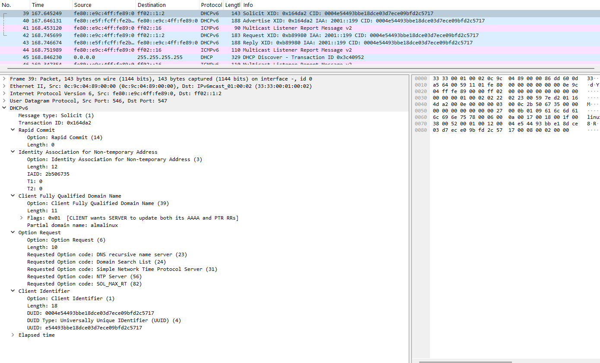{ #fig-029 width=70% }

Сервер отвечает сообщением `Advertise`, предлагая клиенту адрес `2001::199`. Также передаются DNS-сервер `2001::1`, домен поиска `zfagaeva.net` и идентификаторы клиента и сервера (см. рис. [@fig-030]).

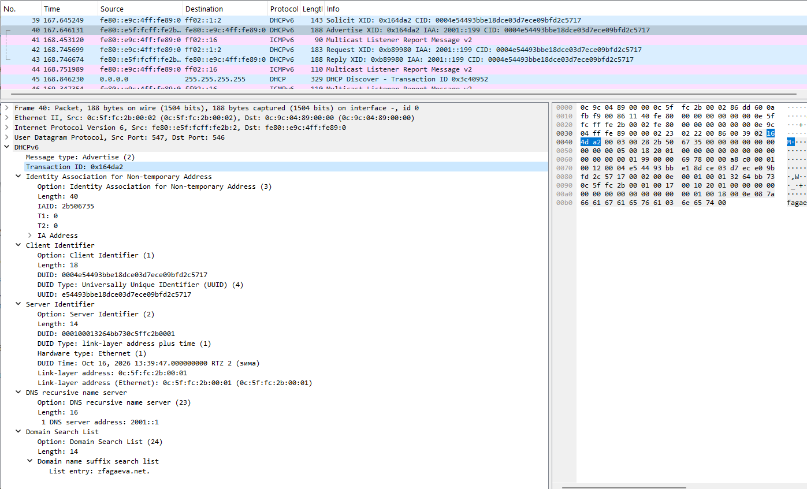{ #fig-030 width=70% }

Клиент отправляет сообщение `DHCPv6 Request`, подтверждая выбор предложенного IPv6-адреса. В пакете содержатся идентификаторы клиента и сервера, а также параметры запроса адреса `IA_NA` (см. рис. [@fig-031]).

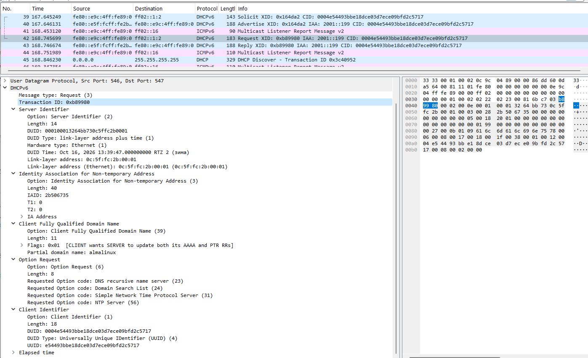{ #fig-031 width=70% }

Сервер завершает обмен сообщением `DHCPv6 Reply`, подтверждая назначение адреса `2001::199` и передачу дополнительных параметров.

В Wireshark наблюдаю последовательность `Solicit → Advertise → Request → Reply`, подтверждающую корректную работу DHCPv6 с отслеживанием состояния (см. рис. [@fig-032]).

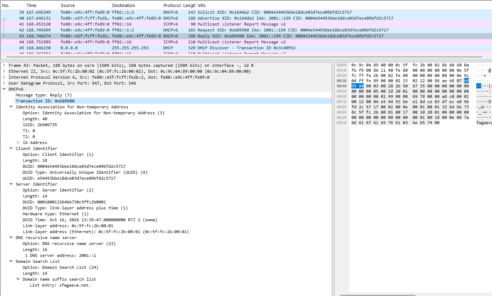{ #fig-032 width=70% }

# Вывод

В ходе лабораторной работы на маршрутизаторе VyOS настроены DHCPv4, Stateless DHCPv6 и Stateful DHCPv6.

Клиент VPCS успешно получил IPv4-адрес `10.0.0.2/24` по DHCP. В режиме Stateless DHCPv6 исследовано автоматическое формирование IPv6-адресов через SLAAC и получение дополнительных параметров от DHCPv6-сервера.

В режиме Stateful DHCPv6 сервер выдал адреса `2001::198` и `2001::199` и зарегистрировал их аренду. На AlmaLinux подтверждено назначение глобального IPv6-адреса, а на Alpine Linux проверены получение аренды и доступность маршрутизатора.

Анализ пакетов в Wireshark позволил изучить последовательности обмена DHCPv4 и DHCPv6 и определить различия между режимами автоматической настройки адресации.

# Список литературы

1. [GNS3. Официальная документация](https://docs.gns3.com/)

2. [VyOS. Настройка Ethernet-интерфейсов и IP-адресации](https://docs.vyos.io/en/1.5/configuration/interfaces/ethernet.html)

3. [VyOS. Настройка DHCP-сервера для IPv4 и IPv6](https://docs.vyos.io/en/1.5/configuration/service/dhcp-server.html)

4. [VyOS. Настройка IPv6 Router Advertisement](https://docs.vyos.io/en/1.5/configuration/service/router-advert.html)

5. [Wireshark. Руководство пользователя](https://www.wireshark.org/docs/wsug_html/)

6. [RFC 2131. Dynamic Host Configuration Protocol (DHCP)](https://www.rfc-editor.org/rfc/rfc2131.html)

7. [RFC 2132. DHCP Options and BOOTP Vendor Extensions](https://www.rfc-editor.org/rfc/rfc2132.html)

8. [RFC 9915. Dynamic Host Configuration Protocol for IPv6 (DHCPv6)](https://www.rfc-editor.org/rfc/rfc9915.html)

9. [RFC 4861. Neighbor Discovery for IP version 6 (IPv6)](https://www.rfc-editor.org/rfc/rfc4861.html)

10. [RFC 4862. IPv6 Stateless Address Autoconfiguration (SLAAC)](https://www.rfc-editor.org/rfc/rfc4862.html)