---
## Author
author:
  name: Агаева Зейнаб Фуад кызы
  email: 1032245473@rudn.ru
  affiliation:
    - name: Российский университет дружбы народов
      country: Российская Федерация
      postal-code: 117198
      city: Москва
      address: ул. Миклухо-Маклая, д. 6

## Title
title: Лабораторная работа №6
subtitle: Адресация IPv4 и IPv6. Настройка маршрутизации по протоколу RIP
license: CC BY
date: today
date-format: "YYYY-MM-DD"
---

# Цели и задачи работы

## Цель лабораторной работы

Изучить принципы динамической маршрутизации в сетях IPv4 и IPv6 с использованием протоколов RIPv2 и RIPng.

Настроить маршрутизацию на оборудовании FRRouting в среде GNS3, проверить сетевую связность и исследовать изменение маршрутов при отказе соединений.

# Построение и настройка сети

## Создаю топологию сети в GNS3

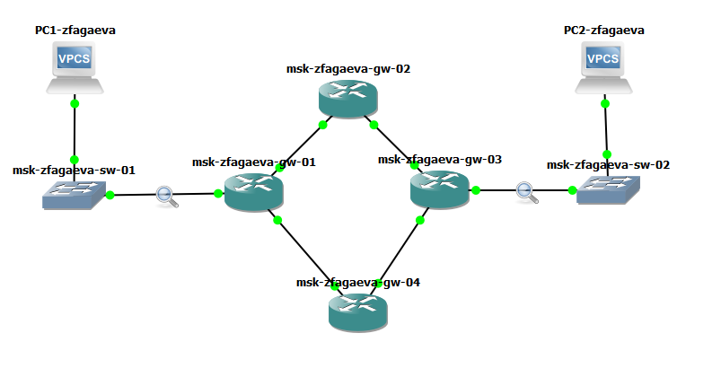{ #fig:001 width=70% height=70% }

## Разрабатываю схему логической адресации L3

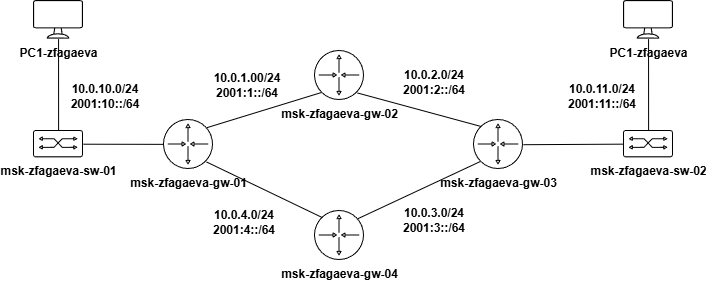{ #fig:002 width=70% height=70% }

## Настраиваю IPv4-адресацию на клиенте PC1

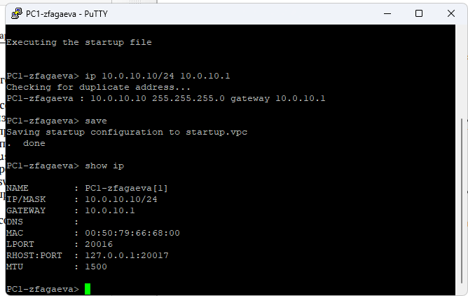{ #fig:003 width=70% height=70% }

## Настраиваю IPv6 на маршрутизаторе gw-01

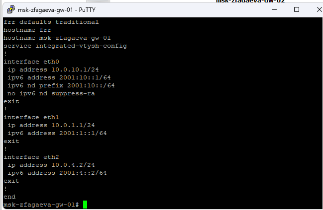{ #fig:004 width=70% height=70% }

# Настройка динамической маршрутизации RIPv2

## Настраиваю протокол RIPv2 на маршрутизаторах

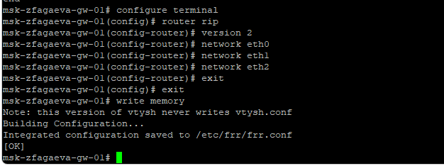{ #fig:005 width=70% height=70% }

## Проверяю таблицу маршрутизации RIPv2

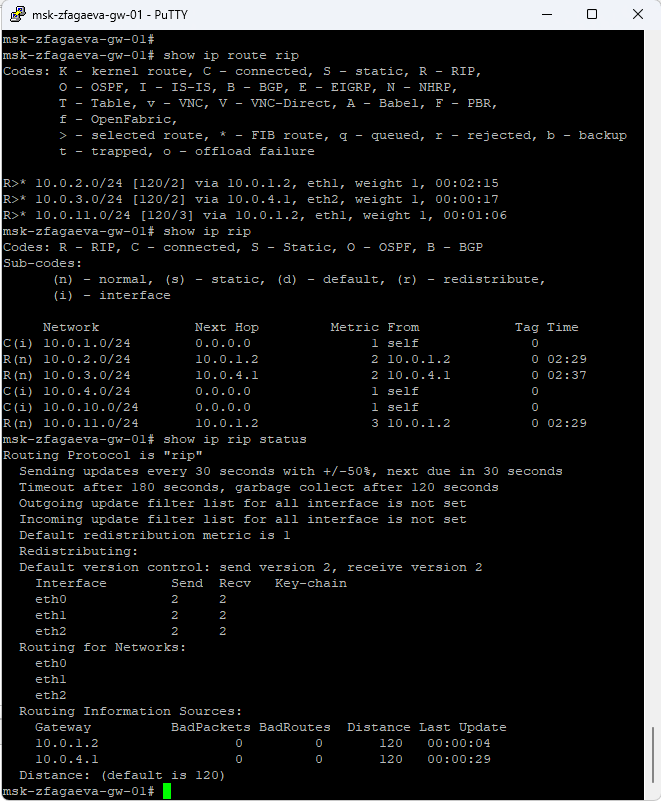{ #fig:006 width=70% height=70% }

## Проверяю доступность IPv4-сетей

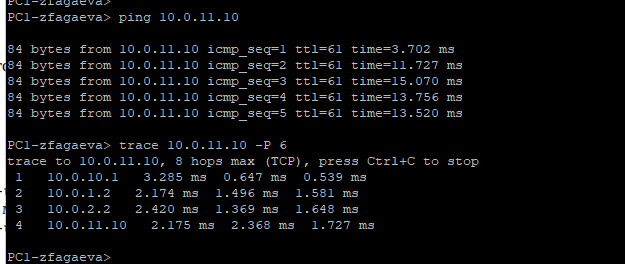{ #fig:007 width=70% height=70% }

# Проверка отказоустойчивости RIPv2

## Отключаю интерфейс маршрутизатора gw-02

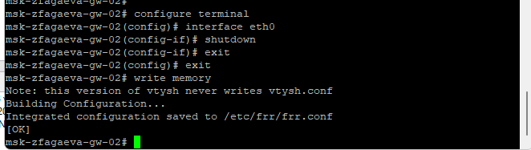{ #fig:008 width=70% height=70% }

## Проверяю альтернативный маршрут IPv4

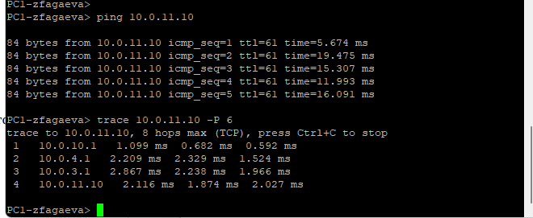{ #fig:009 width=70% height=70% }

# Анализ маршрутных обновлений RIPv2

## Анализирую пакеты RIPv2 в Wireshark

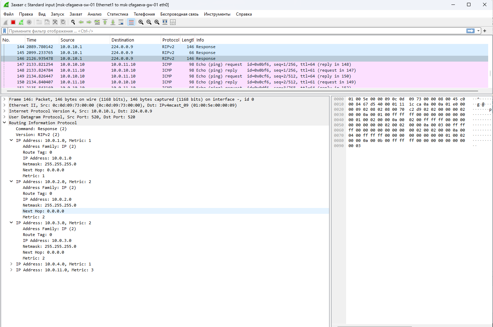{ #fig:010 width=70% height=70% }

# Настройка динамической маршрутизации RIPng

## Настраиваю RIPng для IPv6

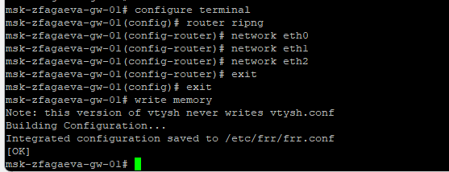{ #fig:011 width=70% height=70% }

## Проверяю IPv6-маршрутизацию

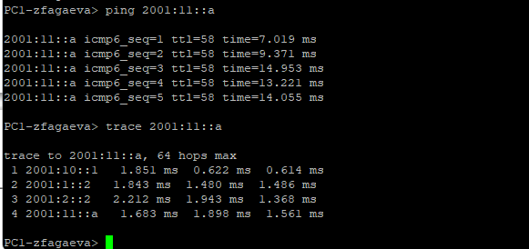{ #fig:012 width=70% height=70% }

## Проверяю таблицу маршрутов RIPng

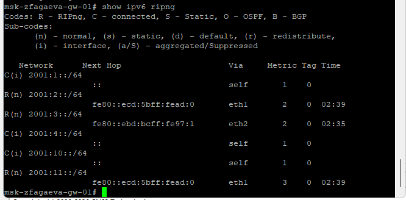{ #fig:013 width=70% height=70% }

# Проверка отказоустойчивости RIPng

## Проверяю альтернативный маршрут IPv6

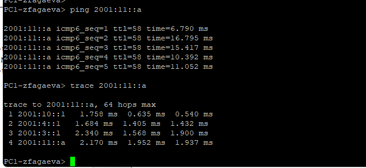{ #fig:014 width=70% height=70% }

# Анализ маршрутных обновлений RIPng

## Анализирую пакеты RIPng в Wireshark

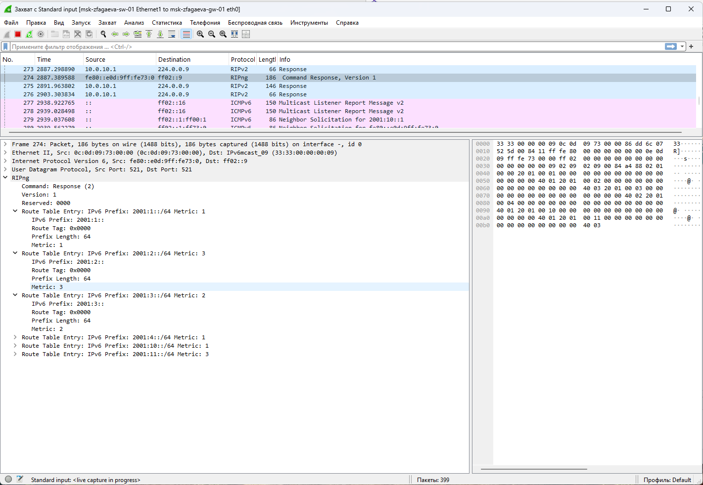{ #fig:015 width=70% height=70% }

# Самостоятельное задание

## Создаю топологию для самостоятельного задания

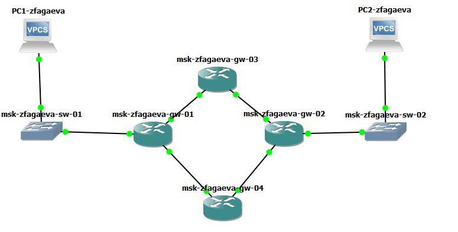{ #fig:016 width=70% height=70% }

## Разрабатываю адресный план сети

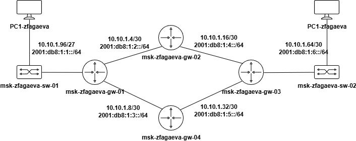{ #fig:017 width=70% height=70% }

## Настраиваю RIPv2 и RIPng на маршрутизаторах

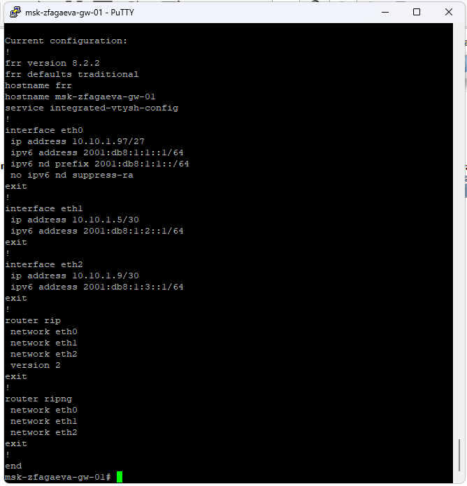{ #fig:018 width=70% height=70% }

## Проверяю соединения IPv4 и IPv6

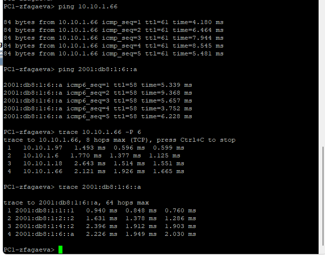{ #fig:019 width=70% height=70% }

## Проверяю динамические маршруты

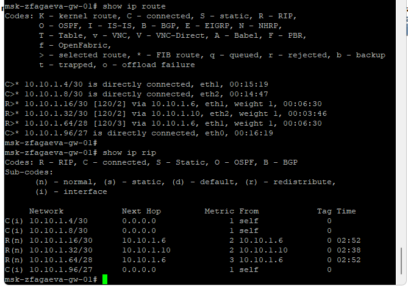{ #fig:020 width=70% height=70% }

# Выводы по проделанной работе

## Вывод

В ходе лабораторной работы построена сеть в GNS3 с четырьмя маршрутизаторами FRR, двумя коммутаторами и двумя клиентами VPCS.

Настроена адресация IPv4 и IPv6, а также динамическая маршрутизация по протоколам RIPv2 и RIPng.

Проверена доступность удалённых сетей с помощью `ping` и `trace`. При отключении соединения маршрутизаторы переключают передачу пакетов на альтернативный путь.

С помощью Wireshark изучены маршрутные обновления RIPv2 и RIPng, используемые многоадресные адреса, UDP-порты и метрики маршрутов.

В самостоятельном задании настроена сеть с другой схемой IPv4- и IPv6-адресации. Проверки подтвердили работоспособность динамической маршрутизации и сетевую связность между клиентами.