---
## Author
author:
  name: Агаева Зейнаб Фуад кызы
  email: 1032245473@rudn.ru
  affiliation:
    - name: Российский университет дружбы народов
      country: Российская Федерация
      postal-code: 117198
      city: Москва
      address: ул. Миклухо-Маклая, д. 6

## Title
title: "Отчёт по лабораторной работе №6"
subtitle: "Адресация IPv4 и IPv6. Настройка маршрутизации по протоколу RIP"
license: "CC BY"
---

# Цель работы

Изучение принципов маршрутизации по протоколу RIP в IPv4- и IPv6-сетях и принципов настройки сетевого оборудования.

# Выполнение лабораторной работы

## Адресация IPv4 и IPv6. Настройка маршрутизации по протоколу RIP

### Построение топологии сети

Создаю проект в GNS3 и размещаю четыре маршрутизатора FRR `msk-zfagaeva-gw-01`, `msk-zfagaeva-gw-02`, `msk-zfagaeva-gw-03`, `msk-zfagaeva-gw-04`, два коммутатора `msk-zfagaeva-sw-01` и `msk-zfagaeva-sw-02`, а также два клиента VPCS `PC1-zfagaeva` и `PC2-zfagaeva`.

Соединяю маршрутизаторы по кольцевой топологии, обеспечивающей два альтернативных пути передачи пакетов между клиентскими сетями. Включаю захват трафика на соединениях между коммутаторами и маршрутизаторами для последующего анализа сообщений RIP (см. рис. [@fig-001]).

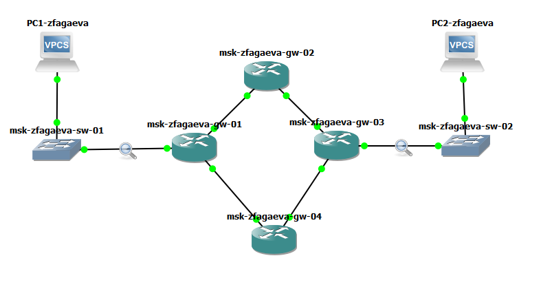{ #fig-001 width=70% }

### Документирование сети

Разрабатываю схему физической топологии L1 с указанием маршрутизаторов, коммутаторов, конечных устройств и интерфейсов подключения (см. рис. [@fig-002]).

{ #fig-002 width=70% }

Создаю схему логической адресации L3, на которой отображаю подсети IPv4 и IPv6 для каждого соединения (см. рис. [@fig-003]).

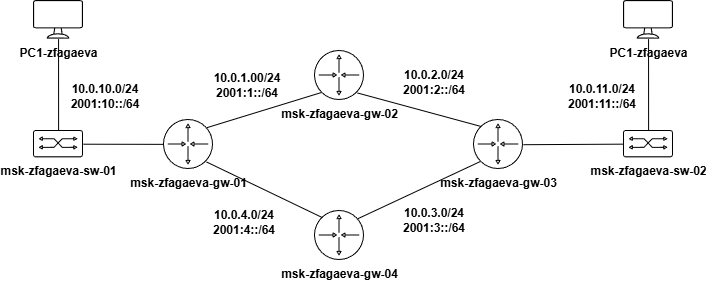{ #fig-003 width=70% }

Использую следующие адреса сетевых сегментов:

| Соединение | Сеть IPv4 | Сеть IPv6 |
|------------|-----------|-----------|
| PC1 — gw-01 | 10.0.10.0/24 | 2001:10::/64 |
| PC2 — gw-03 | 10.0.11.0/24 | 2001:11::/64 |
| gw-01 — gw-02 | 10.0.1.0/24 | 2001:1::/64 |
| gw-02 — gw-03 | 10.0.2.0/24 | 2001:2::/64 |
| gw-03 — gw-04 | 10.0.3.0/24 | 2001:3::/64 |
| gw-04 — gw-01 | 10.0.4.0/24 | 2001:4::/64 |

Распределяю адреса между интерфейсами устройств:

| Устройство | Интерфейс | IPv4-адрес | IPv6-адрес |
|------------|-----------|------------|------------|
| gw-01 | eth0 | 10.0.10.1/24 | 2001:10::1/64 |
| gw-01 | eth1 | 10.0.1.1/24 | 2001:1::1/64 |
| gw-01 | eth2 | 10.0.4.2/24 | 2001:4::2/64 |
| gw-02 | eth0 | 10.0.1.2/24 | 2001:1::2/64 |
| gw-02 | eth1 | 10.0.2.1/24 | 2001:2::1/64 |
| gw-03 | eth0 | 10.0.11.1/24 | 2001:11::1/64 |
| gw-03 | eth1 | 10.0.2.2/24 | 2001:2::2/64 |
| gw-03 | eth2 | 10.0.3.1/24 | 2001:3::1/64 |
| gw-04 | eth0 | 10.0.3.2/24 | 2001:3::2/64 |
| gw-04 | eth1 | 10.0.4.1/24 | 2001:4::1/64 |
| PC1 | NIC | 10.0.10.10/24 | 2001:10::a/64 |
| PC2 | NIC | 10.0.11.10/24 | 2001:11::a/64 |

Для клиента PC1 задаю шлюз IPv4 `10.0.10.1`, для PC2 — `10.0.11.1`.

### Настройка IPv4 на конечных устройствах

На клиенте `PC1-zfagaeva` назначаю IPv4-адрес и шлюз по умолчанию командой:

`ip 10.0.10.10/24 10.0.10.1`

Сохраняю настройки командой `save` и проверяю параметры интерфейса командой `show ip`. Клиент получает адрес `10.0.10.10/24` и шлюз `10.0.10.1` (см. рис. [@fig-004]).

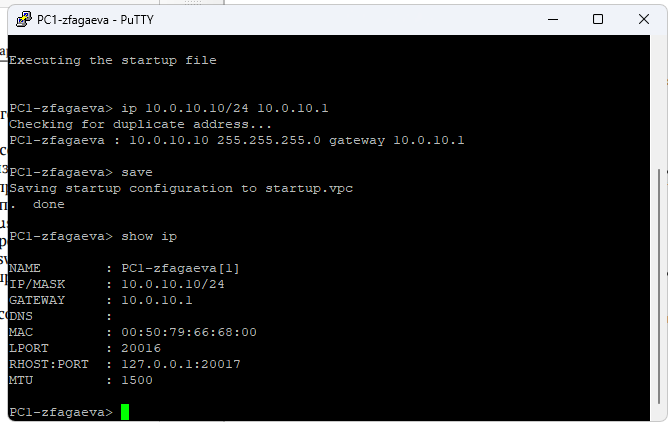{ #fig-004 width=70% }

На клиенте `PC2-zfagaeva` выполняю аналогичную настройку:

`ip 10.0.11.10/24 10.0.11.1`

Сохраняю конфигурацию и проверяю адресацию командой `show ip`. Устройство использует адрес `10.0.11.10/24` и шлюз `10.0.11.1` (см. рис. [@fig-005]).

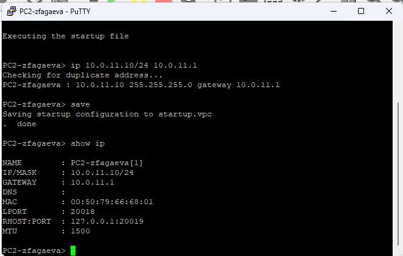{ #fig-005 width=70% }

### Настройка IPv4 на маршрутизаторах FRR

Перехожу в режим конфигурирования маршрутизаторов командой `configure terminal`. Для каждого устройства задаю имя и назначаю IPv4-адреса соответствующим интерфейсам. После настройки сохраняю конфигурацию командой `write memory` и проверяю результат командой `show running-config`.

На маршрутизаторе `msk-zfagaeva-gw-01` назначаю интерфейсам адреса `10.0.10.1/24`, `10.0.1.1/24` и `10.0.4.2/24`. Интерфейсы включаю командой `no shutdown` (см. рис. [@fig-006]).

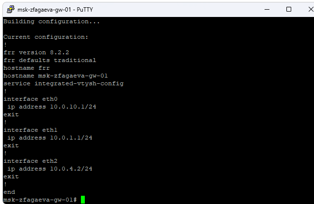{ #fig-006 width=70% }

На маршрутизаторе `msk-zfagaeva-gw-02` настраиваю интерфейс `eth0` с адресом `10.0.1.2/24` и интерфейс `eth1` с адресом `10.0.2.1/24`. Проверяю сохранённую конфигурацию (см. рис. [@fig-007]).

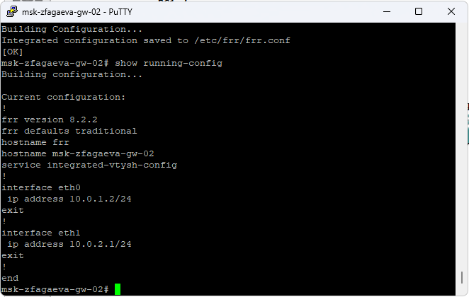{ #fig-007 width=70% }

На маршрутизаторе `msk-zfagaeva-gw-03` назначаю адрес `10.0.11.1/24` интерфейсу `eth0`, `10.0.2.2/24` интерфейсу `eth1` и `10.0.3.1/24` интерфейсу `eth2` (см. рис. [@fig-008]).

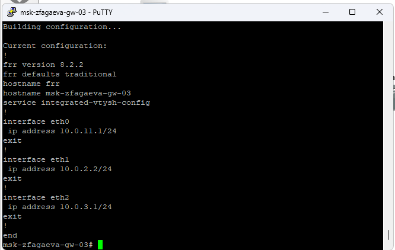{ #fig-008 width=70% }

На маршрутизаторе `msk-zfagaeva-gw-04` настраиваю интерфейсы `eth0` и `eth1`, назначая им адреса `10.0.3.2/24` и `10.0.4.1/24`. Сохраняю настройки и проверяю конфигурацию (см. рис. [@fig-009]).

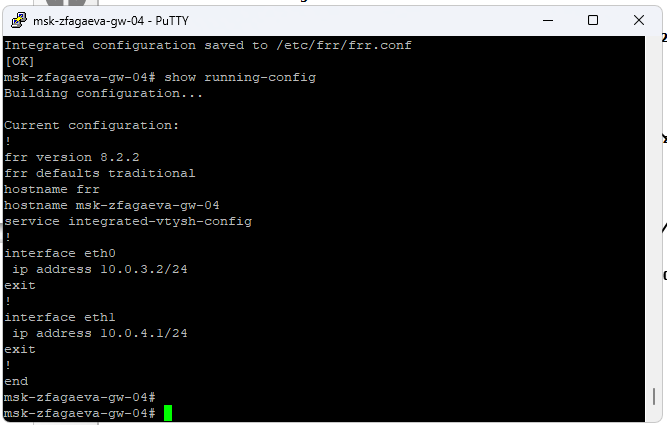{ #fig-009 width=70% }

### Настройка IPv6 на конечных устройствах

На клиенте `PC1-zfagaeva` задаю глобальный IPv6-адрес:

`ip 2001:10::a/64`

Сохраняю конфигурацию командой `save` и проверяю адреса командой `show ipv6`. В результате на интерфейсе присутствуют глобальный адрес `2001:10::a/64` и локальный адрес из диапазона `fe80::/64` (см. рис. [@fig-010]).

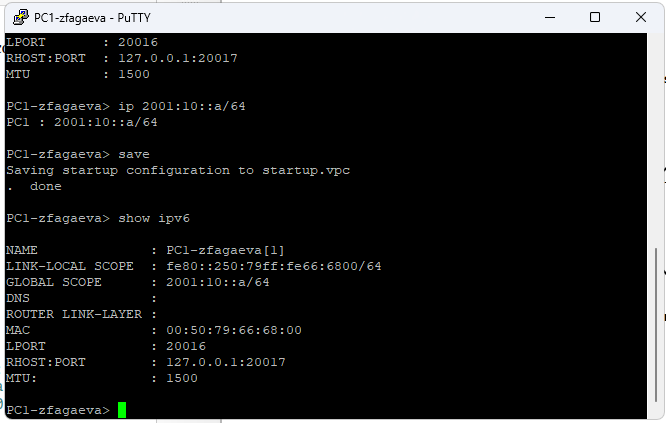{ #fig-010 width=70% }

На клиенте `PC2-zfagaeva` назначаю IPv6-адрес:

`ip 2001:11::a/64`

После сохранения проверяю конфигурацию командой `show ipv6`. Устройство использует глобальный адрес `2001:11::a/64` и автоматически сформированный link-local адрес (см. рис. [@fig-011]).

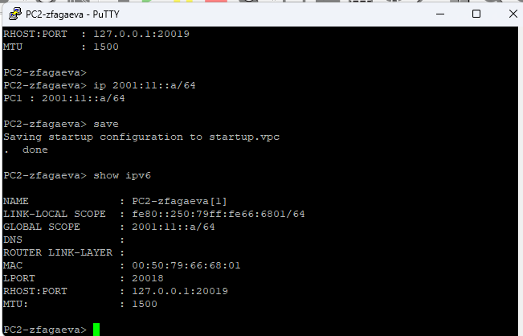{ #fig-011 width=70% }

### Настройка IPv6 на маршрутизаторах FRR

На маршрутизаторах настраиваю IPv6-адресацию и пересылку пакетов между сетями. Для интерфейсов, подключённых к клиентским сегментам, дополнительно настраиваю отправку Router Advertisement с помощью команд `no ipv6 nd suppress-ra` и `ipv6 nd prefix`.

На маршрутизаторе `msk-zfagaeva-gw-01` назначаю интерфейсу `eth0` адрес `2001:10::1/64`, интерфейсу `eth1` — `2001:1::1/64`, интерфейсу `eth2` — `2001:4::2/64`. На клиентском интерфейсе настраиваю анонсирование префикса `2001:10::/64` (см. рис. [@fig-012]).

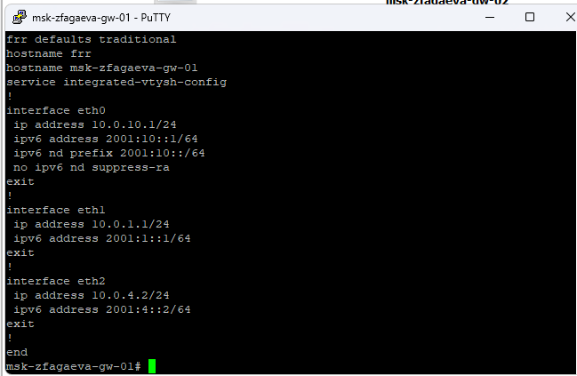{ #fig-012 width=70% }

На маршрутизаторе `msk-zfagaeva-gw-02` задаю IPv6-адрес `2001:1::2/64` интерфейсу `eth0` и `2001:2::1/64` интерфейсу `eth1`. Проверяю назначенные адреса в текущей конфигурации (см. рис. [@fig-013]).

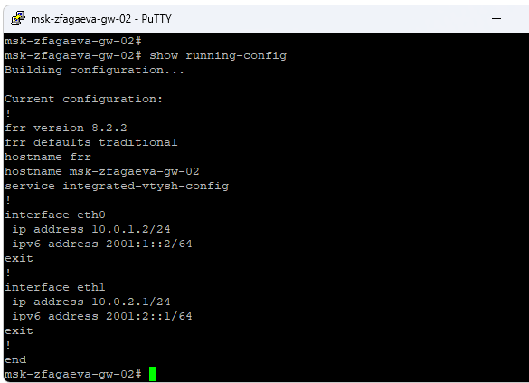{ #fig-013 width=70% }

На маршрутизаторе `msk-zfagaeva-gw-03` назначаю интерфейсам адреса `2001:11::1/64`, `2001:2::2/64` и `2001:3::1/64`. Для интерфейса `eth0` настраиваю анонсирование префикса `2001:11::/64` (см. рис. [@fig-014]).

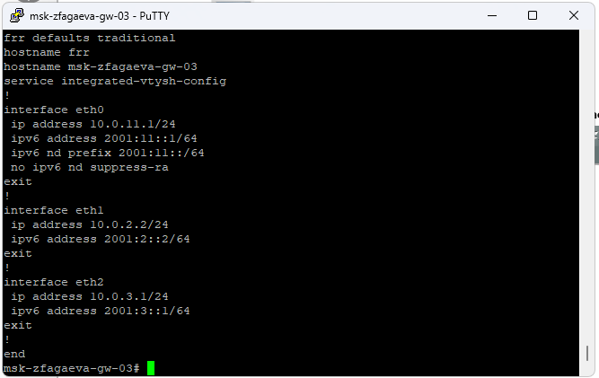{ #fig-014 width=70% }

На маршрутизаторе `msk-zfagaeva-gw-04` назначаю интерфейсу `eth0` адрес `2001:3::2/64`, а интерфейсу `eth1` — `2001:4::1/64`. Сохраняю и проверяю конфигурацию (см. рис. [@fig-015]).

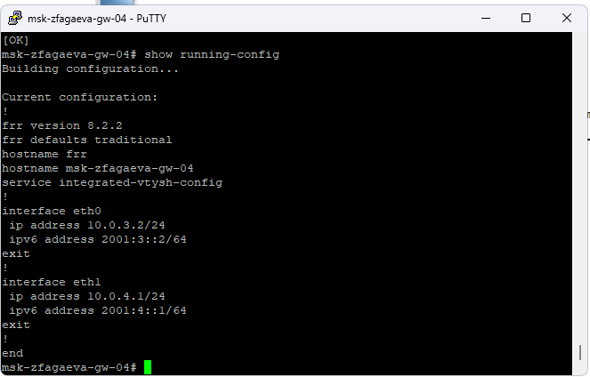{ #fig-015 width=70% }

### Настройка динамической маршрутизации RIPv2

Перехожу к настройке протокола динамической маршрутизации RIP для IPv4. На каждом маршрутизаторе включаю вторую версию протокола командой `version 2` и добавляю необходимые интерфейсы с помощью команды `network`.

На маршрутизаторе `msk-zfagaeva-gw-01` выполняю команды:

`configure terminal`

`router rip`

`version 2`

`network eth0`

`network eth1`

`network eth2`

`exit`

`exit`

`write memory`

В результате маршрутизатор начинает использовать RIPv2 на трёх интерфейсах. Конфигурация успешно сохраняется (см. рис. [@fig-016]).

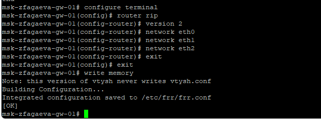{ #fig-016 width=70% }

На маршрутизаторе `msk-zfagaeva-gw-02` включаю RIPv2 для интерфейсов `eth0` и `eth1`. Использую команды `router rip`, `version 2`, `network eth0` и `network eth1`. Сохраняю конфигурацию (см. рис. [@fig-017]).

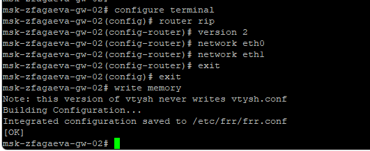{ #fig-017 width=70% }

На маршрутизаторе `msk-zfagaeva-gw-03` включаю протокол RIPv2 и добавляю интерфейсы `eth0`, `eth1` и `eth2`. После завершения настройки выполняю `write memory` (см. рис. [@fig-018]).

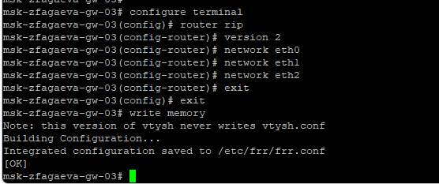{ #fig-018 width=70% }

На маршрутизаторе `msk-zfagaeva-gw-04` активирую RIPv2 на интерфейсах `eth0` и `eth1`. Применяю необходимые команды и сохраняю конфигурацию (см. рис. [@fig-019]).

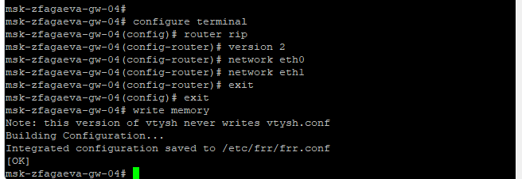{ #fig-019 width=70% }

### Проверка таблиц маршрутизации RIPv2

После настройки протокола проверяю получение динамических маршрутов на каждом маршрутизаторе. Использую команды:

`show ip route rip`

`show ip rip`

`show ip rip status`

На маршрутизаторе `msk-zfagaeva-gw-01` отображаются маршруты к удалённым сетям, полученные по RIP. В частности, сеть `10.0.11.0/24` доступна через следующий узел `10.0.1.2`, а метрика маршрута составляет 3. Команда `show ip rip status` показывает использование RIPv2, интервал рассылки обновлений 30 секунд и административную дистанцию 120 (см. рис. [@fig-020]).

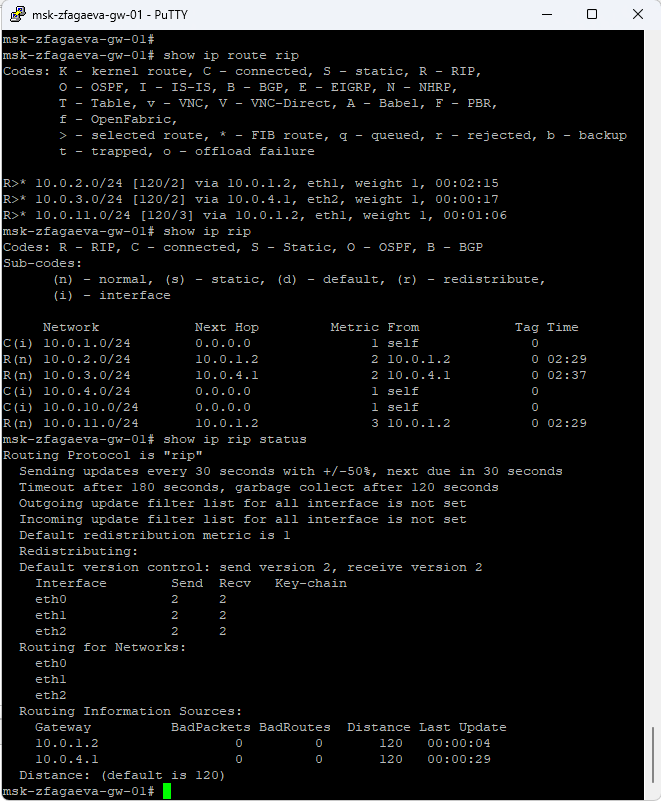{ #fig-020 width=70% }

На маршрутизаторе `msk-zfagaeva-gw-02` проверяю таблицу маршрутизации и параметры протокола. В таблице присутствуют динамические маршруты к сетям `10.0.3.0/24`, `10.0.4.0/24`, `10.0.10.0/24` и `10.0.11.0/24`. Полученные записи содержат адрес следующего узла и метрику маршрута (см. рис. [@fig-021]).

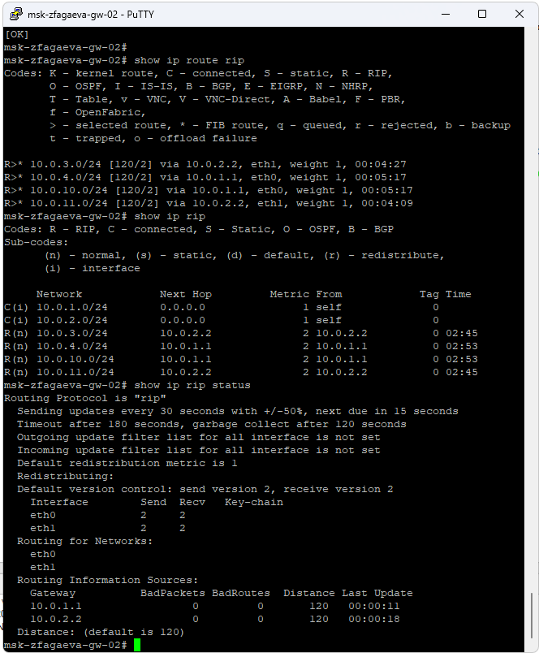{ #fig-021 width=70% }

На маршрутизаторе `msk-zfagaeva-gw-03` выполняю аналогичную проверку. Устройство получает маршруты к удалённым сегментам сети через соседние маршрутизаторы. В выводе отображаются источники маршрутной информации и параметры обновления RIP (см. рис. [@fig-022]).

{ #fig-022 width=70% }

На маршрутизаторе `msk-zfagaeva-gw-04` также проверяю наличие маршрутов RIP. Таблица содержит маршруты к сетям, не подключённым непосредственно к устройству, что подтверждает обмен маршрутной информацией между маршрутизаторами (см. рис. [@fig-023]).

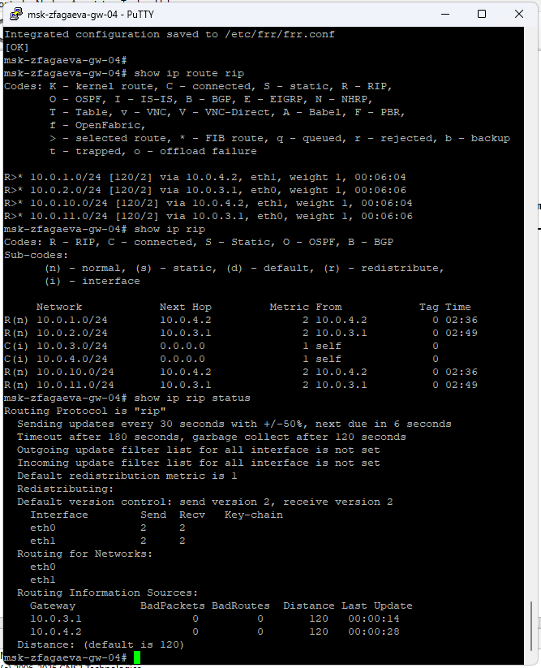{ #fig-023 width=70% }

### Проверка доступности IPv4-сетей

На клиенте `PC1-zfagaeva` проверяю доступность клиента PC2 командой:

`ping 10.0.11.10`

Получаю ответы от узла `10.0.11.10`, что подтверждает работоспособность IPv4-маршрутизации между удалёнными сетями.

Для определения пути следования пакетов выполняю:

`trace 10.0.11.10 -P 6`

Трассировка показывает прохождение пакетов через адреса `10.0.10.1`, `10.0.1.2` и `10.0.2.2` до узла назначения `10.0.11.10`. Трафик проходит через маршрутизаторы `gw-01`, `gw-02` и `gw-03` (см. рис. [@fig-024]).

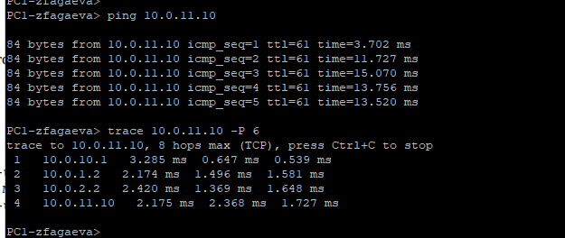{ #fig-024 width=70% }

На маршрутизаторе `msk-zfagaeva-gw-01` дополнительно выполняю команду `show ip rip`. Проверяю значения метрик для удалённых сетей и определяю, что маршрут к сети `10.0.11.0/24` проходит через `10.0.1.2` с метрикой 3 (см. рис. [@fig-025]).

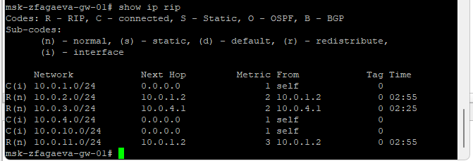{ #fig-025 width=70% }

### Проверка восстановления IPv4-маршрута при отказе соединения

Для моделирования отказа сетевого соединения отключаю интерфейс `eth0` маршрутизатора `msk-zfagaeva-gw-02`, через который первоначально проходит трафик от PC1 к PC2.

Выполняю команды:

`configure terminal`

`interface eth0`

`shutdown`

`exit`

`exit`

`write memory`

Интерфейс отключается, конфигурация сохраняется (см. рис. [@fig-026]).

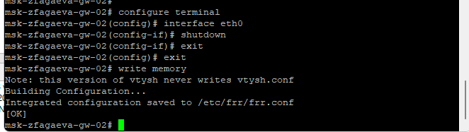{ #fig-026 width=70% }

На маршрутизаторе `msk-zfagaeva-gw-01` повторно проверяю маршруты командами `show ip rip`, `show ip route rip` и `show ip rip status`.

После изменения состояния соединения маршрут к сети `10.0.11.0/24` проходит через соседний маршрутизатор `gw-04` с адресом `10.0.4.1`. Метрика маршрута составляет 3, поскольку альтернативный путь также проходит через три маршрутизатора до целевой сети (см. рис. [@fig-027]).

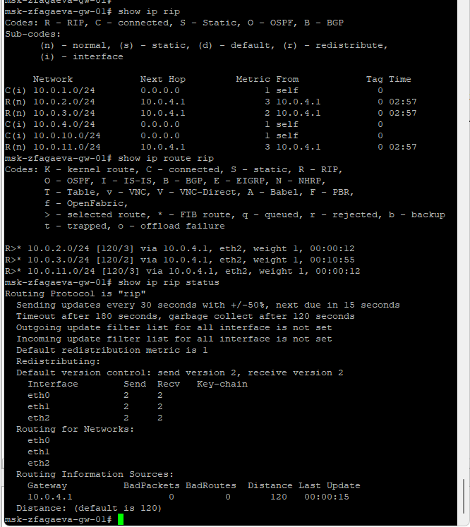{ #fig-027 width=70% }

На клиенте PC1 повторно выполняю команды `ping 10.0.11.10` и `trace 10.0.11.10 -P 6`.

Проверка показывает успешную передачу пакетов по альтернативному маршруту. Трассировка проходит через адреса `10.0.10.1`, `10.0.4.1`, `10.0.3.1` и достигает `10.0.11.10`. Маршрутизация переключается на путь `gw-01 — gw-04 — gw-03` (см. рис. [@fig-028]).

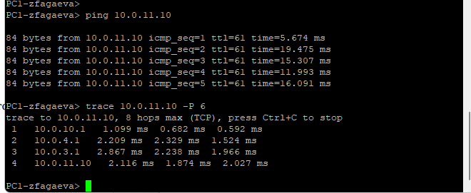{ #fig-028 width=70% }

Восстанавливаю исходное соединение на маршрутизаторе `msk-zfagaeva-gw-02`:

`configure terminal`

`interface eth0`

`no shutdown`

`exit`

`exit`

`write memory`

Интерфейс снова переходит в рабочее состояние (см. рис. [@fig-029]).

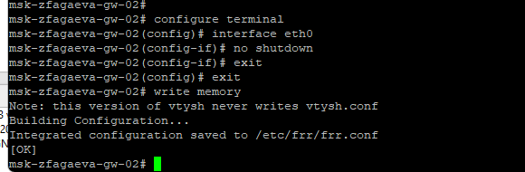{ #fig-029 width=70% }

На маршрутизаторе `gw-01` проверяю маршрутную таблицу командой `show ip rip`. В момент проверки маршрут к сети `10.0.11.0/24` ещё отображается через `10.0.4.1`, что соответствует периоду обновления маршрутной информации после восстановления соединения (см. рис. [@fig-030]).

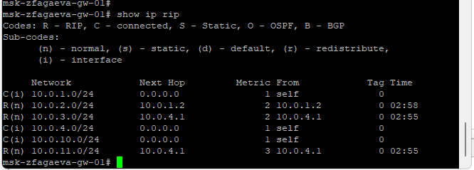{ #fig-030 width=70% }

Повторно проверяю доступность PC2 и выполняю трассировку с PC1. После обновления маршрутов пакеты снова следуют через `10.0.1.2` и `10.0.2.2`, то есть по первоначальному пути через маршрутизатор `gw-02` (см. рис. [@fig-031]).

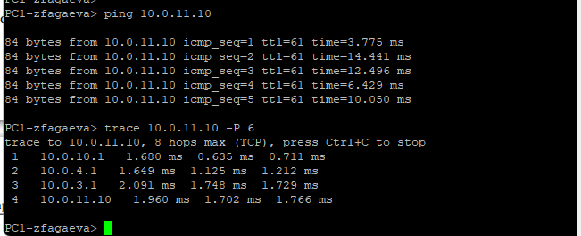{ #fig-031 width=70% }

### Анализ трафика RIPv2 в Wireshark

Открываю захваченный трафик на соединении между `msk-zfagaeva-sw-01` и `msk-zfagaeva-gw-01` в Wireshark.

В захвате наблюдаю пакеты протокола RIPv2, которые отправляются с адреса `10.0.10.1` на многоадресный адрес `224.0.0.9` по протоколу UDP с использованием порта `520`.

В сообщении `Response` отображаются маршрутные записи с адресами сетей, масками и метриками. Например, маршрутизатор анонсирует сеть `10.0.1.0` с метрикой 1, сеть `10.0.2.0` с метрикой 2 и сеть `10.0.11.0` с метрикой 3. В захвате также присутствуют ICMP-пакеты проверки доступности (см. рис. [@fig-032]).

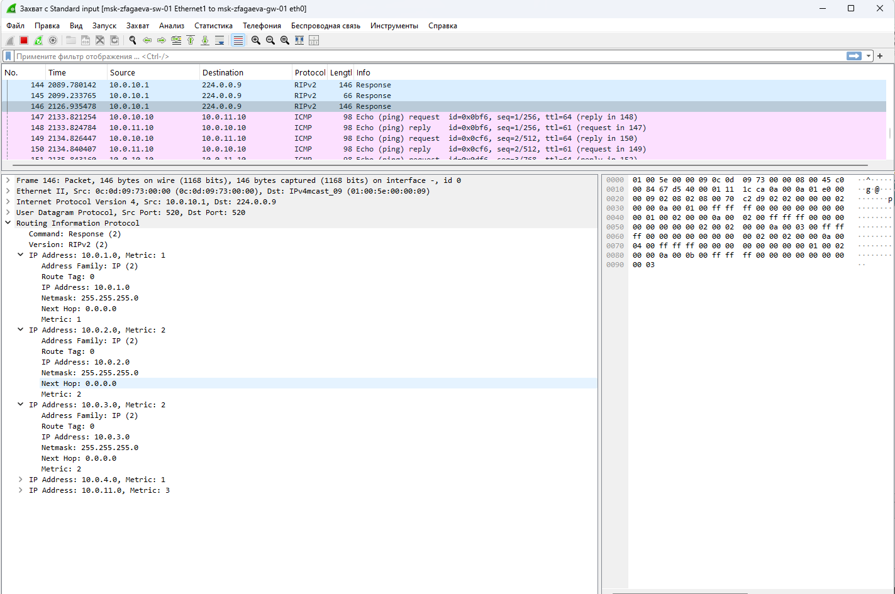{ #fig-032 width=70% }

Анализирую захват на соединении между `msk-zfagaeva-gw-03` и `msk-zfagaeva-sw-02`.

В пакете RIPv2 с источником `10.0.11.1` отображается информация о сетях `10.0.1.0`, `10.0.2.0`, `10.0.3.0`, `10.0.4.0` и `10.0.10.0`. Например, сеть `10.0.3.0` анонсируется с метрикой 1, а сеть `10.0.10.0` — с метрикой 3 (см. рис. [@fig-033]).

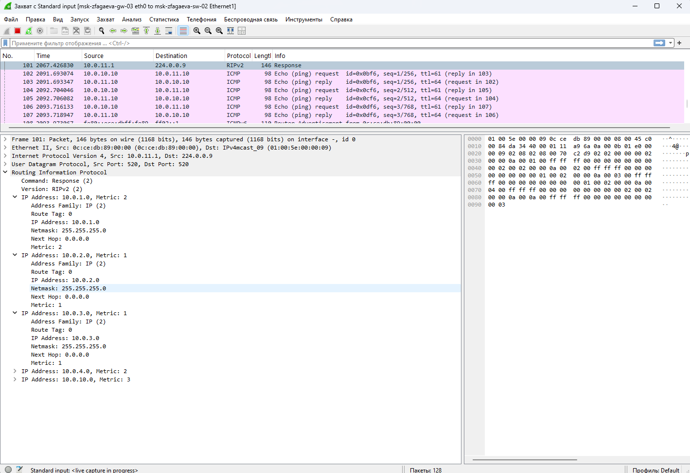{ #fig-033 width=70% }

Захваченные пакеты позволяют определить источник и получателя маршрутных обновлений, версию RIP, список анонсируемых сетей, маски подсетей, адреса следующего узла и значения метрик. Эти данные используются для анализа выбора маршрутов и изменений маршрутной информации.

### Настройка динамической маршрутизации RIPng

Перехожу к настройке протокола RIPng, предназначенного для динамической маршрутизации IPv6. На каждом маршрутизаторе включаю RIPng и добавляю соответствующие сетевые интерфейсы.

На маршрутизаторе `msk-zfagaeva-gw-01` выполняю команды:

`configure terminal`

`router ripng`

`network eth0`

`network eth1`

`network eth2`

`exit`

`exit`

`write memory`

Конфигурация RIPng сохраняется (см. рис. [@fig-034]).

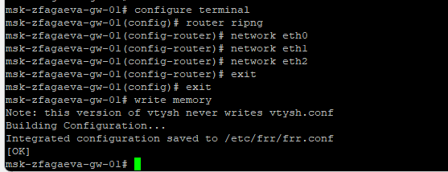{ #fig-034 width=70% }

На маршрутизаторе `msk-zfagaeva-gw-02` включаю RIPng для интерфейсов `eth0` и `eth1`. После настройки сохраняю конфигурацию командой `write memory` (см. рис. [@fig-035]).

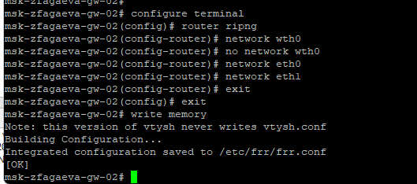{ #fig-035 width=70% }

На маршрутизаторе `msk-zfagaeva-gw-03` добавляю в процесс RIPng интерфейсы `eth0`, `eth1` и `eth2`. Сохраняю настройки маршрутизации (см. рис. [@fig-036]).

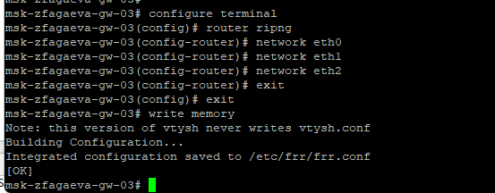{ #fig-036 width=70% }

На маршрутизаторе `msk-zfagaeva-gw-04` включаю RIPng на интерфейсах `eth0` и `eth1`. Сохраняю конфигурацию (см. рис. [@fig-037]).

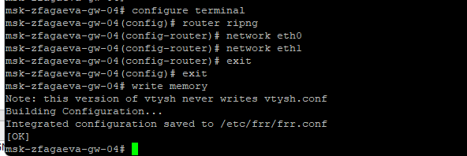{ #fig-037 width=70% }

### Проверка IPv6-маршрутизации

На клиенте `PC1-zfagaeva` проверяю доступность удалённого IPv6-адреса:

`ping 2001:11::a`

Получаю ответы от клиента PC2, что подтверждает работоспособность IPv6-маршрутизации.

Для определения пути передачи пакетов выполняю:

`trace 2001:11::a`

Трассировка показывает прохождение через адреса `2001:10::1`, `2001:1::2` и `2001:2::2` до конечного узла `2001:11::a`. Первоначальный маршрут IPv6 проходит через `gw-01`, `gw-02` и `gw-03` (см. рис. [@fig-038]).

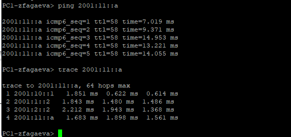{ #fig-038 width=70% }

На маршрутизаторе `msk-zfagaeva-gw-01` выполняю команду:

`show ipv6 ripng`

Проверяю полученные маршруты RIPng. В таблице отображаются непосредственно подключённые IPv6-сети и удалённые префиксы, полученные от соседних маршрутизаторов.

Маршрут к сети `2001:11::/64` имеет метрику 3 и использует следующий узел с link-local IPv6-адресом через интерфейс `eth1` (см. рис. [@fig-039]).

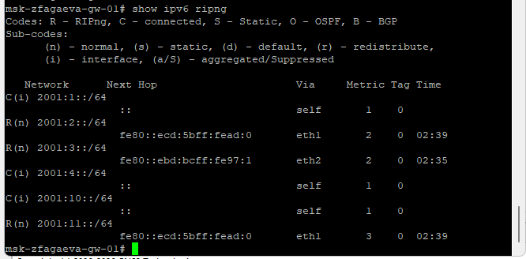{ #fig-039 width=70% }

### Проверка восстановления IPv6-маршрута при отказе соединения

Для проверки переключения маршрутов RIPng отключаю интерфейс `eth0` маршрутизатора `msk-zfagaeva-gw-02`:

`configure terminal`

`interface eth0`

`shutdown`

`exit`

`exit`

`write memory`

После выполнения команды интерфейс отключается (см. рис. [@fig-040]).

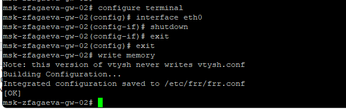{ #fig-040 width=70% }

На маршрутизаторе `msk-zfagaeva-gw-01` повторно выполняю команду `show ipv6 ripng`.

Проверяю обновлённую таблицу маршрутизации. Сеть `2001:11::/64` теперь доступна через интерфейс `eth2` и соседний маршрутизатор `gw-04`. Метрика маршрута остаётся равной 3 (см. рис. [@fig-041]).

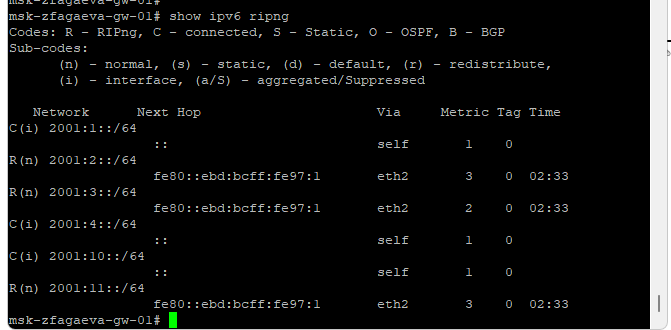{ #fig-041 width=70% }

На клиенте PC1 повторно выполняю `ping 2001:11::a` и `trace 2001:11::a`.

Получаю ответы от удалённого клиента. Трассировка показывает новый маршрут через адреса `2001:10::1`, `2001:4::1` и `2001:3::1` до `2001:11::a`. Пакеты следуют по альтернативному пути `gw-01 — gw-04 — gw-03` (см. рис. [@fig-042]).

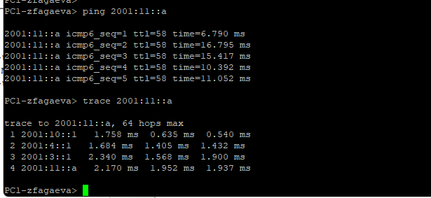{ #fig-042 width=70% }

Восстанавливаю интерфейс `eth0` маршрутизатора `msk-zfagaeva-gw-02` командой `no shutdown` и сохраняю конфигурацию:

`configure terminal`

`interface eth0`

`no shutdown`

`exit`

`exit`

`write memory`

Интерфейс возвращается в рабочее состояние (см. рис. [@fig-043]).

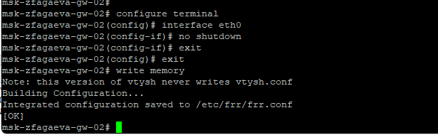{ #fig-043 width=70% }

Проверяю состояние маршрутов RIPng на `gw-01` командой `show ipv6 ripng`. В таблице отображаются маршруты через оба направления кольцевой топологии, а сеть `2001:11::/64` на момент проверки ещё доступна через `eth2` (см. рис. [@fig-044]).

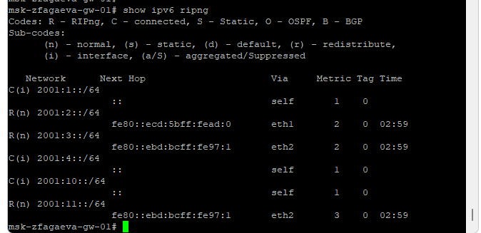{ #fig-044 width=70% }

На PC1 повторяю проверку доступности и трассировку IPv6. Получаю ответы от `2001:11::a`, а маршрут снова проходит через `2001:1::2` и `2001:2::2`, что подтверждает возвращение к первоначальному пути через маршрутизатор `gw-02` (см. рис. [@fig-045]).

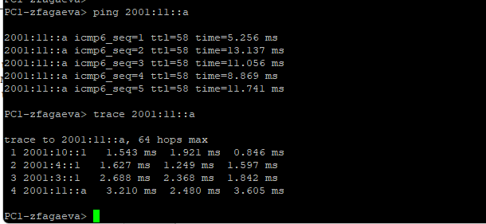{ #fig-045 width=70% }

Переключение между маршрутами происходит после обновления маршрутных таблиц. Протоколы RIPv2 и RIPng обеспечивают сохранение связности при отказе одного из направлений. Точное время восстановления маршрута отдельно не фиксируется.

### Анализ трафика RIPng в Wireshark

Открываю захват трафика на соединении между `msk-zfagaeva-sw-01` и `msk-zfagaeva-gw-01`.

В Wireshark наблюдаю сообщения RIPng, передаваемые на многоадресный IPv6-адрес `ff02::9` по протоколу UDP через порт `521`.

В пакете `Response` содержатся IPv6-префиксы, длины префиксов и метрики маршрутов. Например, отображаются сети `2001:1::/64` с метрикой 1, `2001:2::/64` с метрикой 3 и `2001:11::/64` с метрикой 3. Для передачи используются локальные IPv6-адреса интерфейсов из диапазона `fe80::/10` (см. рис. [@fig-046]).

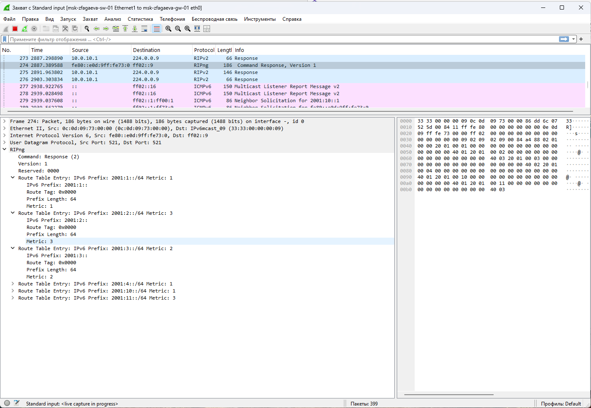{ #fig-046 width=70% }

Анализирую захват трафика на соединении между `msk-zfagaeva-gw-03` и `msk-zfagaeva-sw-02`.

В пакете RIPng присутствуют маршрутные записи для префиксов `2001:1::/64`, `2001:3::/64`, `2001:4::/64` и `2001:10::/64`. Для каждого префикса указана метрика, используемая при выборе маршрута. Также в захвате присутствуют сообщения ICMPv6 и служебные сообщения RIPng (см. рис. [@fig-047]).

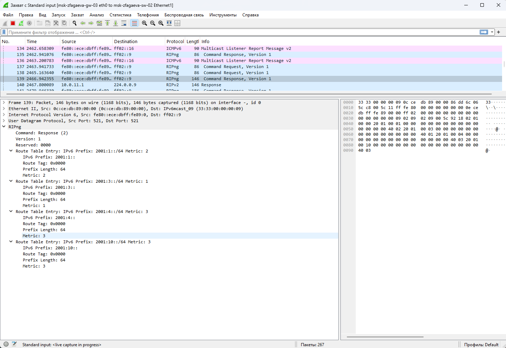{ #fig-047 width=70% }

Анализ пакетов подтверждает, что RIPng использует многоадресную рассылку `ff02::9` и UDP-порт `521`, а маршрутные обновления содержат IPv6-префиксы и метрики. В отличие от RIPv2, адреса соседних маршрутизаторов в IPv6-маршрутах представлены локальными link-local адресами.

## Самостоятельное задание

### Построение топологии сети

Создаю отдельную топологию в GNS3 для самостоятельного задания. Размещаю четыре маршрутизатора FRR, два коммутатора и два клиента VPCS.

Соединяю маршрутизаторы `msk-zfagaeva-gw-01`, `msk-zfagaeva-gw-02`, `msk-zfagaeva-gw-03` и `msk-zfagaeva-gw-04` в кольцо. Клиент PC1 подключаю к `gw-01` через коммутатор `sw-01`, а PC2 — к `gw-02` через `sw-02` (см. рис. [@fig-048]).

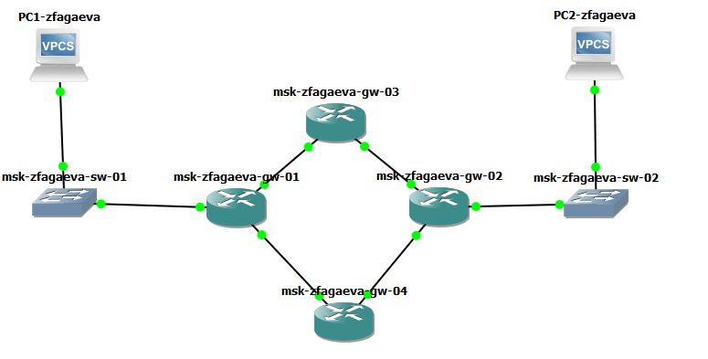{ #fig-048 width=70% }

### Документирование самостоятельной топологии

Создаю схему L1 с указанием используемых устройств и интерфейсов подключения. В новой топологии верхний маршрут проходит через `gw-03`, нижний — через `gw-04` (см. рис. [@fig-049]).

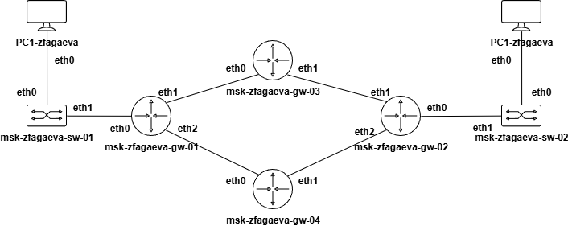{ #fig-049 width=70% }

Разрабатываю схему L3 с адресами сегментов IPv4 и IPv6. Для клиентских сетей использую маски IPv4 `/27` и `/28`, а для межмаршрутизаторных соединений — `/30`. Все IPv6-сегменты имеют префикс `/64` (см. рис. [@fig-050]).

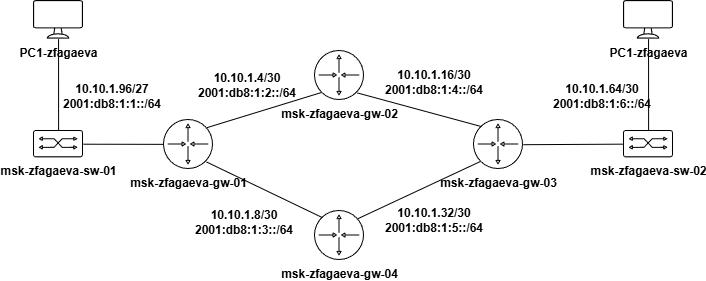{ #fig-050 width=70% }

Использую следующую таблицу адресов сетей:

| Соединение | Сеть IPv4 | Сеть IPv6 |
|------------|-----------|-----------|
| PC1 — gw-01 | 10.10.1.96/27 | 2001:db8:1:1::/64 |
| PC2 — gw-02 | 10.10.1.64/28 | 2001:db8:1:6::/64 |
| gw-01 — gw-03 | 10.10.1.4/30 | 2001:db8:1:2::/64 |
| gw-01 — gw-04 | 10.10.1.8/30 | 2001:db8:1:3::/64 |
| gw-03 — gw-02 | 10.10.1.16/30 | 2001:db8:1:4::/64 |
| gw-04 — gw-02 | 10.10.1.32/30 | 2001:db8:1:5::/64 |

Для сегмента `10.10.1.8/30` использую соединение `gw-01 — gw-04` в соответствии с построенной топологией и фактическими конфигурациями устройств.

Распределяю адреса между устройствами:

| Устройство | Интерфейс | IPv4-адрес | IPv6-адрес |
|------------|-----------|------------|------------|
| gw-01 | eth0 | 10.10.1.97/27 | 2001:db8:1:1::1/64 |
| gw-01 | eth1 | 10.10.1.5/30 | 2001:db8:1:2::1/64 |
| gw-01 | eth2 | 10.10.1.9/30 | 2001:db8:1:3::1/64 |
| gw-02 | eth0 | 10.10.1.65/28 | 2001:db8:1:6::1/64 |
| gw-02 | eth1 | 10.10.1.18/30 | 2001:db8:1:4::2/64 |
| gw-02 | eth2 | 10.10.1.34/30 | 2001:db8:1:5::2/64 |
| gw-03 | eth0 | 10.10.1.6/30 | 2001:db8:1:2::2/64 |
| gw-03 | eth1 | 10.10.1.17/30 | 2001:db8:1:4::1/64 |
| gw-04 | eth0 | 10.10.1.10/30 | 2001:db8:1:3::2/64 |
| gw-04 | eth1 | 10.10.1.33/30 | 2001:db8:1:5::1/64 |
| PC1 | NIC | 10.10.1.98/27 | 2001:db8:1:1::a/64 |
| PC2 | NIC | 10.10.1.66/28 | 2001:db8:1:6::a/64 |

В качестве шлюза IPv4 для PC1 использую `10.10.1.97`, для PC2 — `10.10.1.65`.

### Настройка IPv4 и IPv6 на конечных устройствах

На клиенте `PC1-zfagaeva` назначаю IPv4-адрес `10.10.1.98/27`, шлюз `10.10.1.97` и IPv6-адрес `2001:db8:1:1::a/64`.

Проверяю конфигурацию командами:

`show ip`

`show ipv6`

В результате отображаются назначенные IPv4- и IPv6-адреса. На интерфейсе также присутствует link-local IPv6-адрес (см. рис. [@fig-051]).

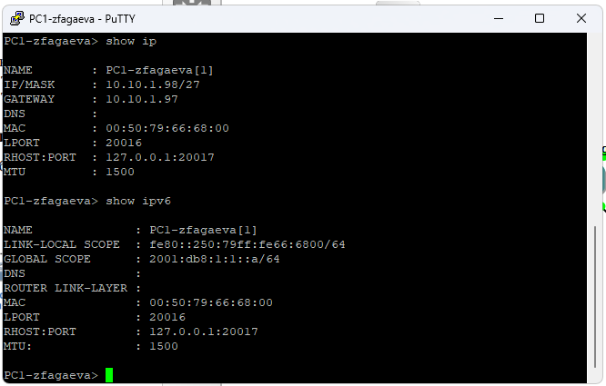{ #fig-051 width=70% }

На клиенте `PC2-zfagaeva` задаю IPv4-адрес `10.10.1.66/28`, шлюз `10.10.1.65` и IPv6-адрес `2001:db8:1:6::a/64`.

Проверяю параметры интерфейса командами `show ip` и `show ipv6`. Оба адреса назначены корректно (см. рис. [@fig-052]).

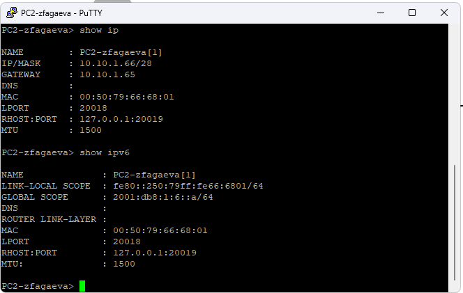{ #fig-052 width=70% }

### Настройка маршрутизаторов для самостоятельного задания

На каждом маршрутизаторе настраиваю IPv4- и IPv6-адреса интерфейсов, включаю динамическую маршрутизацию RIPv2 и RIPng. После конфигурирования сохраняю настройки командой `write memory` и проверяю их командой `show running-config`.

На маршрутизаторе `msk-zfagaeva-gw-01` назначаю интерфейсам адреса `10.10.1.97/27`, `10.10.1.5/30`, `10.10.1.9/30` и соответствующие IPv6-адреса из сетей `2001:db8:1:1::/64`, `2001:db8:1:2::/64`, `2001:db8:1:3::/64`.

Включаю RIPv2 командой `router rip`, устанавливаю `version 2` и добавляю интерфейсы `eth0`, `eth1`, `eth2`. Аналогичные интерфейсы добавляю в процесс `router ripng`. Проверяю итоговую конфигурацию (см. рис. [@fig-053]).

{ #fig-053 width=70% }

На маршрутизаторе `msk-zfagaeva-gw-02` назначаю интерфейсу `eth0` адрес `10.10.1.65/28`, интерфейсу `eth1` — `10.10.1.18/30`, интерфейсу `eth2` — `10.10.1.34/30`.

Дополнительно настраиваю IPv6-адреса `2001:db8:1:6::1/64`, `2001:db8:1:4::2/64` и `2001:db8:1:5::2/64`. Активирую RIPv2 и RIPng на трёх интерфейсах (см. рис. [@fig-054]).

{ #fig-054 width=70% }

На маршрутизаторе `msk-zfagaeva-gw-03` настраиваю два интерфейса. Для `eth0` использую адреса `10.10.1.6/30` и `2001:db8:1:2::2/64`, для `eth1` — `10.10.1.17/30` и `2001:db8:1:4::1/64`.

Включаю RIPv2 и RIPng на интерфейсах `eth0` и `eth1`. Проверяю сохранённые параметры (см. рис. [@fig-055]).

{ #fig-055 width=70% }

На маршрутизаторе `msk-zfagaeva-gw-04` задаю интерфейсу `eth0` адреса `10.10.1.10/30` и `2001:db8:1:3::2/64`, интерфейсу `eth1` — `10.10.1.33/30` и `2001:db8:1:5::1/64`.

Настраиваю RIPv2 и RIPng на обоих интерфейсах, сохраняю конфигурацию и проверяю результат (см. рис. [@fig-056]).

{ #fig-056 width=70% }

### Проверка соединений IPv4 и IPv6 между PC1 и PC2

На клиенте `PC1-zfagaeva` проверяю доступность удалённого клиента по IPv4:

`ping 10.10.1.66`

Получаю ответы от адреса `10.10.1.66`, что подтверждает наличие маршрута к сети `10.10.1.64/28`.

Проверяю соединение IPv6 командой:

`ping 2001:db8:1:6::a`

Ответы от удалённого узла подтверждают работоспособность маршрутизации IPv6.

Определяю путь прохождения пакетов командами:

`trace 10.10.1.66 -P 6`

`trace 2001:db8:1:6::a`

Для IPv4 трассировка проходит через адреса `10.10.1.97`, `10.10.1.6` и `10.10.1.18`. Для IPv6 пакеты последовательно проходят через `2001:db8:1:1::1`, `2001:db8:1:2::2` и `2001:db8:1:4::2`.

Оба маршрута проходят через `gw-01`, `gw-03` и `gw-02` (см. рис. [@fig-057]).

{ #fig-057 width=70% }

На клиенте `PC2-zfagaeva` выполняю проверку доступности PC1:

`ping 10.10.1.98`

`ping 2001:db8:1:1::a`

Получаю ответы от обоих адресов. Затем выполняю трассировку:

`trace 10.10.1.98 -P 6`

`trace 2001:db8:1:1::a`

IPv4-пакеты проходят через `10.10.1.65`, `10.10.1.17`, `10.10.1.5` и достигают `10.10.1.98`. IPv6-пакеты проходят через `2001:db8:1:6::1`, `2001:db8:1:4::1`, `2001:db8:1:2::1` и достигают `2001:db8:1:1::a`.

Результаты подтверждают двустороннюю связность клиентов в сетях IPv4 и IPv6 (см. рис. [@fig-058]).

{ #fig-058 width=70% }

### Проверка таблиц маршрутизации на gw-01

На маршрутизаторе `msk-zfagaeva-gw-01` проверяю IPv4-маршруты командами:

`show ip route`

`show ip rip`

В таблице присутствуют непосредственно подключённые сети `10.10.1.96/27`, `10.10.1.4/30` и `10.10.1.8/30`, а также удалённые сети, полученные по RIP.

Сеть `10.10.1.64/28` доступна через `10.10.1.6` с метрикой 3. Это соответствует маршруту через `gw-03` к `gw-02` (см. рис. [@fig-059]).

{ #fig-059 width=70% }

Проверяю IPv6-маршруты командами:

`show ipv6 route`

`show ipv6 ripng`

В таблице отображаются подключённые IPv6-сети и маршруты RIPng к удалённым сегментам. Для сети `2001:db8:1:6::/64` используется маршрут через интерфейс `eth1` с метрикой 3.

В качестве адреса следующего узла применяется link-local IPv6-адрес соседнего маршрутизатора (см. рис. [@fig-060]).

{ #fig-060 width=70% }

### Проверка таблиц маршрутизации на gw-02

На маршрутизаторе `msk-zfagaeva-gw-02` выполняю команды `show ip route` и `show ip rip`.

В таблице отображаются непосредственно подключённые сети `10.10.1.64/28`, `10.10.1.16/30` и `10.10.1.32/30`. Маршруты к удалённым сегментам получены по RIPv2.

Сеть PC1 `10.10.1.96/27` доступна через адрес `10.10.1.17` с метрикой 3. Маршрут проходит через `gw-03` (см. рис. [@fig-061]).

{ #fig-061 width=70% }

Проверяю маршрутизацию IPv6 командами `show ipv6 route` и `show ipv6 ripng`.

В таблице RIPng присутствуют маршруты к удалённым префиксам. Сеть `2001:db8:1:1::/64` доступна через интерфейс `eth1` с метрикой 3. Непосредственно подключённые сети имеют метрику 1 (см. рис. [@fig-062]).

{ #fig-062 width=70% }

### Проверка таблиц маршрутизации на gw-03

На маршрутизаторе `msk-zfagaeva-gw-03` проверяю IPv4-маршруты командами `show ip route` и `show ip rip`.

Непосредственно подключённые сети `10.10.1.4/30` и `10.10.1.16/30` имеют метрику 1. Маршрут к клиентской сети PC1 `10.10.1.96/27` проходит через `10.10.1.5` с метрикой 2, а маршрут к сети PC2 `10.10.1.64/28` проходит через `10.10.1.18` с метрикой 2 (см. рис. [@fig-063]).

{ #fig-063 width=70% }

Проверяю IPv6-маршрутизацию командами `show ipv6 route` и `show ipv6 ripng`.

Маршрутизатор получает маршруты к клиентским сетям `2001:db8:1:1::/64` и `2001:db8:1:6::/64` через соседние устройства. Для обеих клиентских сетей в таблице RIPng отображается метрика 2 (см. рис. [@fig-064]).

{ #fig-064 width=70% }

### Проверка таблиц маршрутизации на gw-04

На маршрутизаторе `msk-zfagaeva-gw-04` выполняю команды `show ip route` и `show ip rip`.

В таблице присутствуют непосредственно подключённые сети `10.10.1.8/30` и `10.10.1.32/30`, а также динамические маршруты RIPv2 к остальным сегментам.

Сеть `10.10.1.96/27` доступна через `10.10.1.9`, а сеть `10.10.1.64/28` — через `10.10.1.34`. Обе клиентские сети имеют метрику 2, поскольку доступны через соседние маршрутизаторы (см. рис. [@fig-065]).

{ #fig-065 width=70% }

Проверяю IPv6-маршруты командами `show ipv6 route` и `show ipv6 ripng`.

В таблице отображаются маршруты к сетям `2001:db8:1:1::/64` и `2001:db8:1:6::/64` с метрикой 2. В качестве следующих узлов указаны link-local адреса соседних маршрутизаторов через интерфейсы `eth0` и `eth1`.

Результаты подтверждают корректное распространение IPv6-маршрутов протоколом RIPng (см. рис. [@fig-066]).

{ #fig-066 width=70% }

# Вывод

В ходе лабораторной работы построена сеть в GNS3 с четырьмя маршрутизаторами FRR, двумя коммутаторами и двумя клиентами VPCS. Выполнена адресация IPv4 и IPv6, разработаны схемы L1 и L3, настроена динамическая маршрутизация по протоколам RIPv2 и RIPng.

Проверены таблицы маршрутизации, метрики и пути прохождения пакетов. При отключении интерфейса одного из маршрутизаторов трафик переключается на альтернативный маршрут, а после восстановления соединения возвращается к первоначальному пути. Анализ захваченных пакетов в Wireshark позволил изучить состав маршрутных обновлений RIPv2 и RIPng, адреса многоадресной рассылки и используемые метрики.

В самостоятельном задании настроена сеть с другой схемой адресации и префиксами IPv4 различной длины. Успешные проверки `ping` и `trace`, а также таблицы маршрутизации на всех четырёх маршрутизаторах подтверждают работоспособность IPv4- и IPv6-соединений и динамического распространения маршрутов.

# Список литературы

1. [GNS3. Официальная документация](https://docs.gns3.com/)

2. [GNS3. Создание сетевой топологии и настройка VPCS](https://docs.gns3.com/docs/getting-started/your-first-gns3-topology)

3. [FRRouting. Настройка динамической маршрутизации RIP для IPv4](https://docs.frrouting.org/en/latest/ripd.html)

4. [FRRouting. Настройка протокола RIPng для IPv6](https://docs.frrouting.org/en/latest/ripngd.html)

5. [FRRouting. Настройка IPv6 и Router Advertisement](https://docs.frrouting.org/en/latest/ipv6.html)

6. [RFC 2453. RIP Version 2 — спецификация протокола RIPv2](https://www.rfc-editor.org/info/rfc2453/)

7. [RFC 2080. RIPng for IPv6 — спецификация протокола RIPng](https://www.rfc-editor.org/info/rfc2080/)

8. [Wireshark. Официальное руководство по захвату и анализу сетевого трафика](https://www.wireshark.org/docs/wsug_html_chunked/)